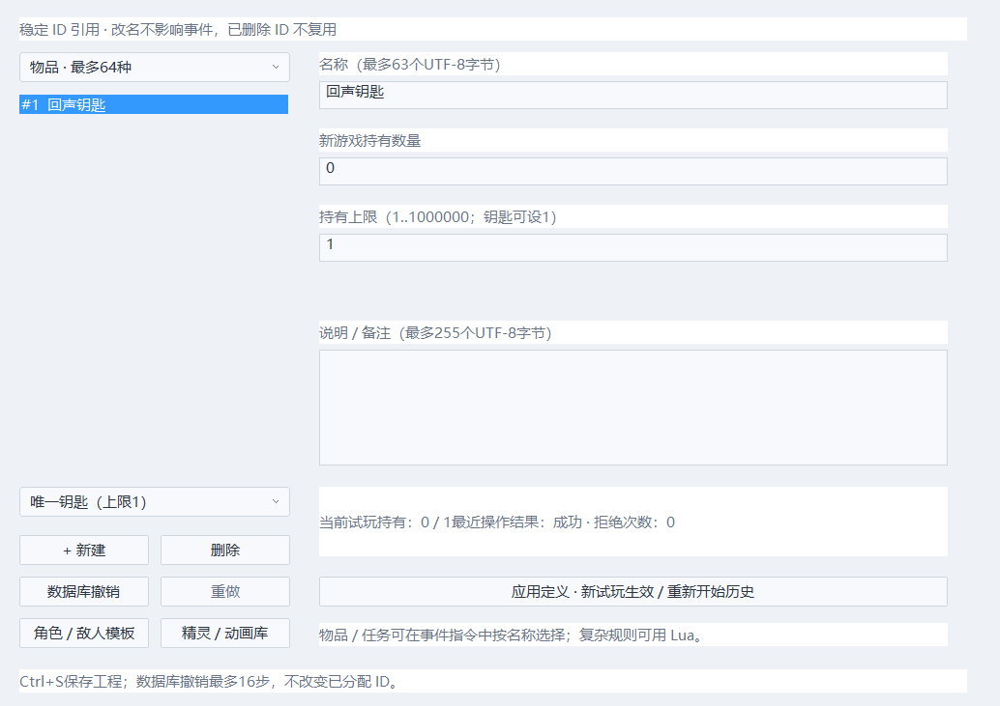
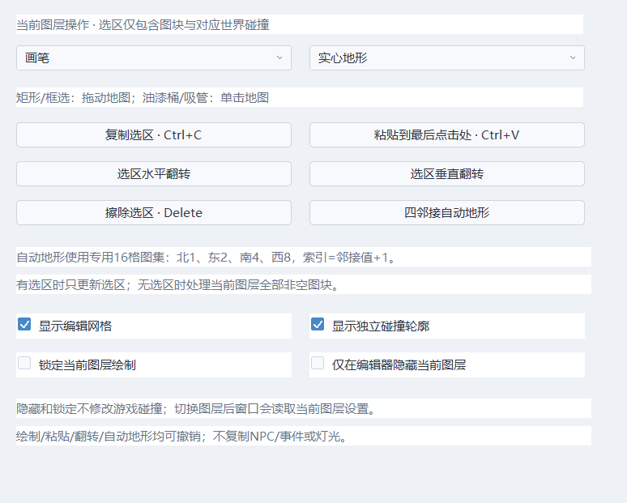
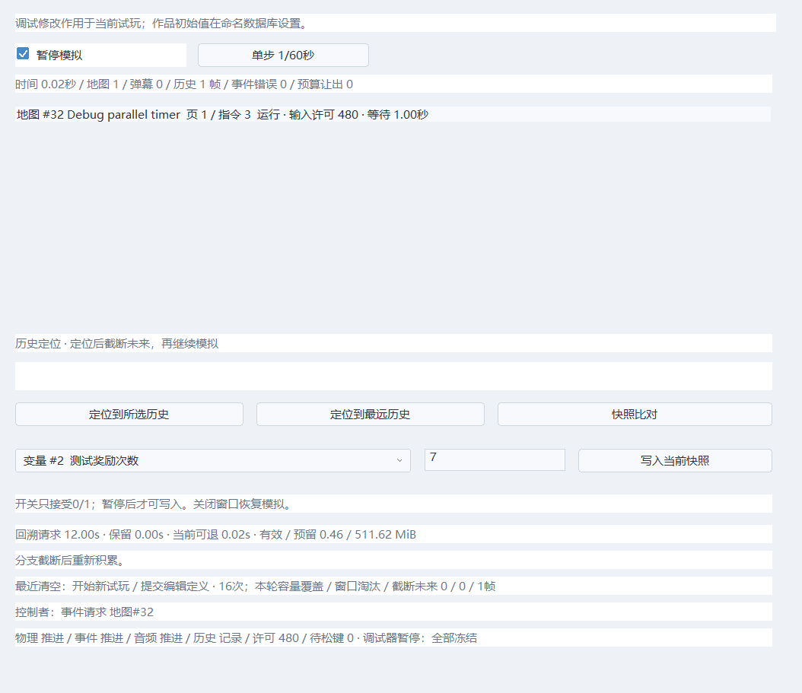

# 制作易用性：命名数据、批量地图、试玩调试与恢复

Echo Engine 0.4 新增四个原生窗口。常用操作使用表单，复杂行为仍可调用 Lua。数据定义与运行时状态分开：数据库存名称、备注、初始值；实际开关/变量继续放在 WorldState 中。

## 游戏数据库

「作品 → 游戏数据库」选择128个全局开关或64个整数变量，填写名称、初始值、备注后点「应用」，Ctrl+S保存。开关只能0/1；变量为有符号32位整数。名称最多63、备注最多255 UTF-8字节，超限报错，不静默截断。

事件条件下拉框、指令目标和指令列表显示编号与名称。引用保存稳定编号；重命名不会改坏既有事件。旧工程没有 database.echo 时全部默认0，仍可加载。初始值在加载项目时先应用，再执行 Lua 参数脚本，随后新试玩使用这些值。运行中修改只在调试器进行，不会回写作品初始值。

示例工程已经给引导开关、全局计时和奖励次数命名。数据库有16步独立撤销/重做，稳定ID不复用；请先应用再切换条目，尚未应用的表单文字不会保存。物品数量/单目标任务也在同一窗口，常见配置使用预设，事件按名称选择；详见 [物品与任务](INVENTORY_QUESTS.md)。

## 地图批量工具

顶部「地图批量工具」提供：

- 画笔：当前地形、图块索引连续绘制。
- 矩形填充：按下、拖动、松开，一次撤销覆盖整个矩形；支持反向拖动。
- 油漆桶：四方向连通填充；世界层开启自动碰撞时也按原碰撞类型划分连通区。固定2304格队列，不无限递归。
- 框选：拖出当前图层选区；Ctrl+C复制、Ctrl+V贴到最后点击位置、Delete擦除，快捷键只在地图画布有焦点时生效。
- 吸管：读取图块与世界地形，不修改地图。
- 水平/垂直翻转：翻转选区格子排列，不翻转单块纹理。
- 四邻接地形：专用16格图集，北1/东2/南4/西8，tile编号=掩码+1；有选区只处理选区，没有选区处理整层非空格。

示例提供 assets/autotile16.png（4×4图集、单格8像素），可从「导入图块」选择，再对铺好的地形执行四邻接更新。当前普通图集仍用于一般绘制。

图块复制同时复制世界层碰撞；前/后景复制不会凭空生成世界碰撞。完整粘贴越界时拒绝，不部分裁切。批量改动均进入现有64步/64 MiB编辑撤销预算。当前不复制NPC、灯、传送区域、独立形状碰撞；16格地形规则不等于RPG Maker完整自动图块系统，普通美术图集不要直接点此操作。

网格、独立碰撞轮廓、当前层锁定/隐藏是本次编辑会话的显示设置。隐藏不改变游戏显示定义或碰撞，锁定不禁止编辑事件/独立碰撞。切换图层后复选框读取该层设置。这些会话设置尚未写入工程。

## 试玩调试

「试玩调试器」从当前地图启动试玩并暂停。可以暂停/继续、单步1/60秒，查看当前地图、世界时间、弹幕数、历史帧数、事件错误和指令预算让出次数。事件列表显示地图/公共事件、当前页、指令游标、运行状态、等待时间、等待对话/公共事件以及移动剩余时间。事件执行仍使用原有固定预算。

选择命名开关/变量，填写值，在暂停时点「写入当前快照」。变更只影响当前试玩；运行中、T/R尚未结束时拒绝修改。快照之间发生修改时新增快照，同一世界时间修改则替换当前槽。Lua快照/恢复钩子仍执行。

历史滑块选择帧，「定位到所选历史」或「定位到最远历史」全量恢复并截断旧未来，增加时间线代次；这是真实分支，会改变当前试玩。摄像机直接跟随。禁用回溯时不允许历史定位。关闭调试窗口恢复模拟并移除调试碰撞显示；F2返回编辑。

「快照比对」固定一份A，选择当前世界或历史帧作B；支持路径筛选及TSV导出。比对不改变世界和历史；历史定位仍会分支。调试器同时解释请求窗口与实际可退时长、预算、积累/冻结、清空原因和丢弃帧数。详细操作和新增字段维护见 [回溯诊断](SNAPSHOT_DIAGNOSTICS.md)。

## 工程检查与自动恢复

「工程检查与恢复」检查当前已应用的编辑内容：玩家/Boss/tiles/背景/过渡shader、音乐/SE/Lua、图层图片与头像引用；地图目标、公共事件调用、孤立事件定义/放置、空SE槽、出生点越界/位于地砖、重复数据名称。列表最多512项，显示文件/事件编号。检查存在性与解析/引用一致性，不能证明Lua运行行为、shader正确性、关卡可达性、所有形状碰撞或游戏平衡；这些仍需试玩。

编辑状态、工程有修改时每60秒自动保存；也可点「保存恢复点」。.echo目录保留 latest、previous、before-restore 三份，单份序列化上限32 MiB，原子替换。内容是项目配置、当前编辑地图与事件、公共事件、命名数据库。不备份图片、音频、shader源或Lua文件；切换地图仍沿用已有先保存流程。

恢复先验证版本、长度、路径白名单、地图/事件解析和引用，再检查资源；恢复前另写当前编辑内容备份。恢复载入编辑器内存，标记工程有修改，Ctrl+S才提交；未保存的恢复内容禁止直接通过资源API导出。最新恢复文件无效时不会自动尝试上一代；previous/before-restore文件可保留用于后续人工处理，界面当前仅恢复latest。资产损坏需要另行修复。

发布扫描排除整个.echo目录，公开和加密包均不带恢复资料。恢复不是玩家存档；WorldState的原始内存不能当稳定存档格式。项目各文件保存分别原子替换，整个工程尚未支持多文件事务。

测试包含命名数据库严格解析、矩形/桶/粘贴/翻转/锁定/撤销、调试分支、30 Hz中间步写值、原生窗口交互、恢复后保存、恢复工程退到最远并继续、公开/加密包排除恢复数据。

事件指令也提供分类搜索、原生多选/结构剪贴板、按真实PC折叠、16状态/8MiB本页撤销，并在应用时继续提交地图/事件/弹幕共享历史。列表焦点与文本编辑快捷键分开，具体操作见 [事件成组编辑](EVENT_EDITING.md)。
