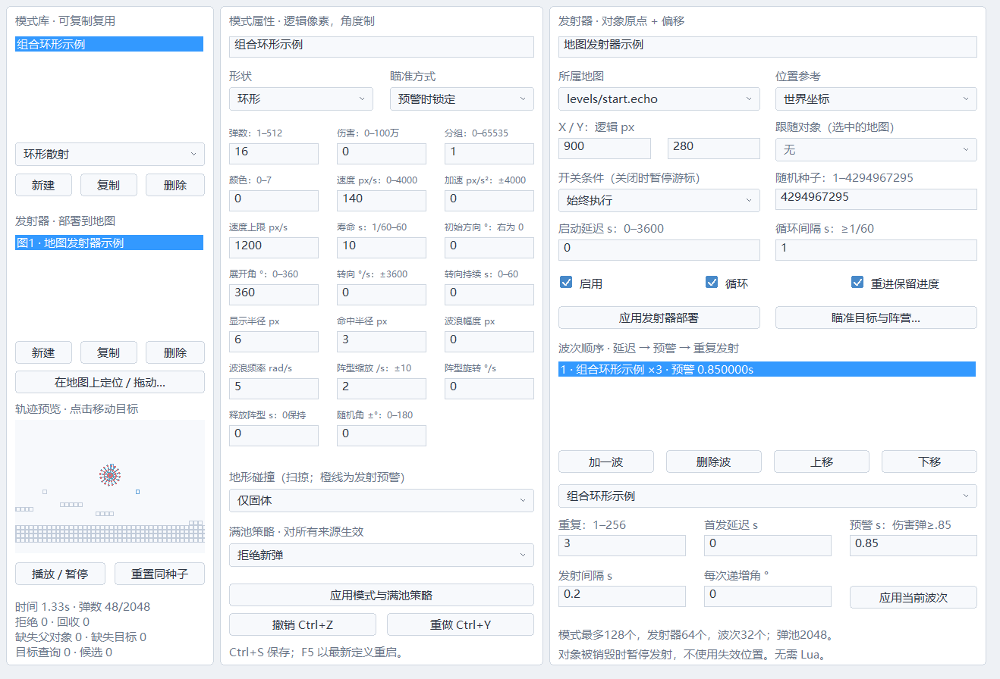

# 弹幕制作
顶部“弹幕与波次”打开原生编辑器。浅色与石板灰深色主题都支持，常见配置不需要 Lua。

1. 在左侧选择环形散射、瞄准扇形、旋转弧线、波浪弹或扩散阵型，点“新建”。模式可复制、命名和复用。
2. 中间设置形状、固定方向／临发瞄准／预警锁定、弹数、展开角、速度、加速、寿命、转向、波浪与阵型参数。角度为度，速度与尺寸是逻辑像素；悬停参数显示完整单位和范围。
3. 创建发射器，选择地图与世界／玩家／Boss／地图对象原点，填写偏移。跟随对象用命名下拉选择，不需要记运行时 ID。点「瞄准目标与阵营…」选择玩家、Boss、指定对象、最近对象或固定世界坐标；对象按稳定部署ID保存，查询与运行槽索引分离。
4. 在右侧顺序添加波次。每波包含模式、首发延迟、预警、重复次数、间隔和递增角。伤害弹预警至少 0.85 秒。
5. 点击播放查看隔离的真实模拟，点击预览移动目标，重置会使用相同种子。可对照显示点、红色判定框和橙色发射预警；保留最近约两秒轨迹。预览最多画前 512 发，全 2048 发仍模拟。
6. 应用后 Ctrl+S 保存，F5 用最新定义开启新时间线。修改定义不修改过去的试玩快照。

模式库、发射器与波次保存在 barrage.echo（ECHO_BARRAGE_2；兼容读取v1，旧文件默认瞄准玩家），最多 128 模式、64 发射器、32 波／发射器、512 弹／次。每固定模拟步最多尝试发射 4096 弹，超额计数拒绝，不积累无限任务。关闭开关条件暂停该发射器游标；对象不存在时暂停并增加缺失父对象诊断。

每个发射器有独立非零 32 位随机种子，最大值可精确填写。抖动、波次、锁定坐标、游标、循环、启用状态、重进策略、种子、弹幕加速／阵型释放／px/py／分组均在 WorldState。重进可选择保留或从种子和启动延迟重置。事件“开启并重新开始”也恢复初始种子与启动延迟。

地形模式为穿透、仅固体、固体加单向平台。检测上一位置到当前位置的扫掠；同一帧墙和玩家同时候选时按首次接触处理。单向平台只阻挡从上方穿下的弹幕。圈／凸形的地形检测使用已有扫掠系统；当前子弹圆形对地形采用保守 AABB。

2048 弹池满时可选择拒绝新弹、按年龄与 ID 回收最旧弹、只回收同组最旧弹；不存在同组可回收弹时拒绝。策略与计数进快照，对 Boss／Lua／通用炮台来源也一致。它会改变玩法，应由作者明确选择；没有按帧率随机删除玩法弹。

地图和公共事件已有“控制弹幕发射器”“清除弹幕分组”。目标下拉保存稳定发射器 ID，旧 ECHO_EVENTS_1/2 可读取，保存为 ECHO_EVENTS_7。复杂脚本可在运行钩子中调用：
```lua
engine.set_emitter(3, true, false) -- ID、启用、重启
engine.clear_bullet_group(2)
```
定义加载期间尚未创建运行实例；脚本顶层不能代替发射器表单默认配置。

尚需扩展：预警随复杂运动的完整未来轨迹、跨项目预设依赖迁移。当前炮台模板自带简易发射行为；使用波次发射器替代时把模板行为改成待机，避免叠加两套攻击。

性能记录：15_barrage 运行 18000 步／模拟 300 秒，始终维持 2048 发，含波浪、部分地形检查与完整历史记录，验证运行步零堆分配，输出 P95/P99/最慢步、预留历史和进程峰值工作集到 out/build/gcc-release/barrage-performance.txt。这是有界场景，不替代完整项目、长时 GPU 和多设备测量。

## 目标、失效和性能规则

- 固定方向不查询目标。瞄准方向以选中目标中心为基准，再加模式初始方向与波次递增角。玩家采用实际受击区域中心；Boss/对象采用实体中心。
- 指定/最近对象支持任意阵营、仅选择该阵营或排除该阵营。阵营是0–65535的精确编号，沿用对象模板中的阵营设置。最近对象半径0表示不限，最多16384逻辑像素；只扫描活跃地图的存活对象，可排除发射器跟随对象。同距离按稳定运行ID选择，避免槽位复用改变排序。
- 「预警时锁定」保存当时坐标与方向；目标销毁或移动后仍按原方向发射，不解引用旧句柄。「临发瞄准」在预警期间更新目标；目标缺失时把波次退到本次预警起点，等待可用目标，然后重新走完整预警。缺失不会消耗随机种子、发射预算或重复次数。开关关闭仍暂停游标。
- 锁定坐标、目标ID/句柄代次、有效/等待标记进快照。目标查询每固定步按发射器缓存一次；同一步追赶多个波次也复用结果。64个发射器最多扫描16384个对象槽，与2048发弹池数量无乘积关系。查询不做Lua调用、不分配堆内存。
- 预览会画地图对象轮廓、橙色目标十字及发射预警，显示缺失目标、查询和槽候选计数。点击预览移动玩家；对象目前保持静态，尚不是完整AI未来轨迹预测。指定对象删除后，重新打开表单会显示缺失引用；工程检查/导出检查能定位该发射器。
- 这些阵营选项控制**瞄准对象选择**。当前普通弹幕命中伤害仍走玩家战斗规则，通用对象受弹伤害/阵营伤害路由仍属待建设能力。


[石板灰深色](previews/barrage-target-dark.png)

## LuaSTG 参考

查阅了 [LuaSTG Sub 的 GameObjectPool 实现](https://github.com/Legacy-LuaSTG-Engine/LuaSTG-Sub/blob/master/LuaSTG/LuaSTG/GameObject/GameObjectPool.cpp)及[官方更新记录](https://github.com/Legacy-LuaSTG-Engine/LuaSTG-Sub-Documentation/blob/main/history.md)。参考点包括池分配、稳定对象身份、分组检测列表和检测/回调分阶段。Echo已有固定紧凑弹池，本次继续采用稳定身份与有界查询，独立实现目标选择；没有引入LuaSTG运行时、代码或素材。

LuaSTG新碰撞接口将检测结果先缓存，再分派回调。Echo的通用弹幕碰撞候选分组、延迟回调、通用受弹伤害和复杂场景空间索引仍待建设，不能把查阅参考视为已完成这些功能。普通作者继续使用表单，复杂Lua任务的持久进度必须由C++快照保存。

15_barrage另测64个发射器同时查询256个活跃对象：600步、每步16384候选，验证零堆分配，并单独报告目标查询P95/P99/最慢步。18000步弹幕场景报告的当前工作集是长测结束时的进程占用，峰值工作集则包含此前两个384 MiB历史的回溯验收，不能将该峰值当作弹幕池本身成本。

## 地图定位、拖动与撤销

1. 应用发射器部署参数，确保当前编辑地图与发射器所属地图一致；点左侧「在地图上定位 / 拖动…」。表单暂时隐藏，画布左键确定落点，右键取消等待落点。
2. 发射器显示为方框与十字。工具保持选中时，可以抓住标记拖动；保留抓取偏移，松开提交一次操作。双击标记重新打开表单。鼠标捕获中断会提交最后一个有效位置，可撤销。
3. 世界原点直接修改位置；玩家/Boss以该地图出生点、跟随对象以部署点换算偏移。定位不解除挂接，正式试玩仍跟随对应运行对象。坐标保留浮点，编辑拖动不强制吸附地砖。其他地图或缺失对象原点需要先切图/修复引用。
4. 表单「撤销 / 重做」、画布Ctrl+Z/Y及主工具栏使用**同一个**地图/事件/弹幕历史。模式/波次/部署/目标/满池策略均覆盖；一次连续拖动只记录一次，点击选择、右键取消等待、无变化应用和验证失败不记录。
5. 弹幕窗口的非文本控件支持Ctrl+Z/Y；文本框内Ctrl+Z仍编辑文本。未应用表单字段不是作品历史，撤销会用恢复后的定义刷新相关表单。新增操作清空重做；稳定对象/发射器/模式ID分配进度不回退。
6. 每个撤销/重做栈最多64项、64MiB，计入预留UndoState存储、事件内容、弹幕模式/发射器/波次数组。超限淘汰最旧项，两个栈合计上限128MiB，应用中的定义与一次操作临时副本另计。切换地图清栈但保留项目弹幕库；当前还没有跨图撤销和可视操作历史列表。
7. 发射器删除会检查所有地图（含非活动地图）和公共事件中的发射器指令引用，存在引用时先要求修改指令。试玩期间作者撤销不会修改当前模拟；Ctrl+S保存，F5复制新定义并开启新的历史。



[石板灰深色](previews/barrage-dark.png) · [实际地图标记](previews/barrage-map.png)

22_barrage_authoring覆盖统一操作顺序、属性深拷贝、ID不复用、预算淘汰、世界/玩家/Boss/对象相对原点、选择/取消/连续拖动，以及30/60/120Hz完整六秒最远恢复再T/R继续。原生07通过实际鼠标按下/移动/松开、捕获中断、双击、表单撤销/重做、非法/无变化应用、跨图事件引用及保存试玩检查。
