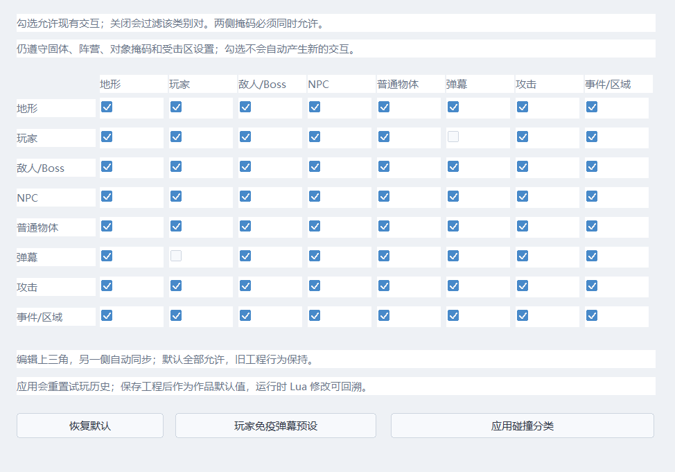

# 碰撞分类、区域触发与事件移动

打开工具栏「碰撞分类」即可配置，不需要 Lua。矩阵和运行进度属于 WorldState，恢复快照时一起恢复。

实际窗口：



[深色主题](previews/collision-rules-dark.png) · [区域与移动表单](previews/event-collision-route.png)

## 分类矩阵

八类为地形、玩家、敌人/Boss、NPC、普通物体、弹幕、攻击、事件/区域。编辑上三角，另一侧自动同步；双侧掩码同时允许才交互。默认全部允许，旧工程没有 collision_rules 时采用默认值。

矩阵用于过滤已有交互，仍受实体固体属性、对象原有 category/mask、阵营、弹幕 terrain 选项、受击区伤害过滤影响。勾选不会把装饰物变成墙，也不会让没有伤害的物体产生伤害。

- 地形包含图块、独立碰撞形状和平台；地图范围限制与越界死亡仍保留。
- 普通对象按 kind 分为玩家、敌人/Boss、NPC 或普通物体。
- 事件/区域包括实体事件、区域触发、地图传送区和区域对话。
- 弹幕过滤影响普通弹幕/蓝封条伤害及已有地形消弹查询；R的穿弹、琥珀制动和退出清弹仍遵循时间系统规则。
- 攻击过滤用于动画攻击与其接收方；阵营过滤和命中收据仍有效。
- Boss 的专用移动算法尚未统一为通用物理体；这是后续对象/战斗系统的范围。

「玩家免疫弹幕预设」关闭玩家与弹幕的交互；仍可被其他伤害来源命中。应用矩阵会重置试玩历史，并显示“应用碰撞分类”原因；Ctrl+S保存、导出携带配置。关闭窗口不会提交未应用修改。

复杂行为可在 Lua 中调整当前世界：
```lua
engine.set_collision_pair("player", "projectile", false)
local enabled = engine.collision_pair("player", "projectile")
```
类别名为 terrain/player/enemy/npc/prop/projectile/attack/trigger。运行时修改自动进快照；不需要 Lua 自己缓存矩阵。

## 区域事件

部署地图事件后，关闭「实体碰撞」即可作为纯触发区域。触发方式可选：

| 方式 | 行为 |
|---|---|
| 玩家接触（兼容模式）/进入区域 | 外到内触发一次，离开再进入可重新触发 |
| 离开区域 | 内到外触发一次 |
| 持续接触 | 接触期间，上一轮指令链结束后再启动；不是每帧并发创建实例 |

这三种方式仍使用已有前台事件控制规则。常用计数例子可直接应用「进入计数」「离开计数」「接触计数」预设，再在变量指令里选择命名变量。公共事件没有地图区域，不能使用这些触发方式。

当前区域是玩家实体矩形与事件矩形，包含相切接触；它独立于腹部受击点。相邻采样使用玩家与移动区域的相对扫掠，快速从区域一侧穿到另一侧仍能检测进入/离开。

进入/离开信号在前台忙碌时保留一个待执行标记；同页重复信号合并，不建立无限队列。持续接触只在仍接触时启动。页面变化取消旧待执行信号并保留接触采样，避免仅因换页产生第二次进入；取消页或消除事件会释放它拥有的前台控制和对话。关闭玩家/区域交互会清除待触发标记，不合成一次离开。

接触标记、上一帧玩家/区域矩形、待触发标记都进快照。恢复一个已经在区域内的时刻不会无缘由再次触发；退到真正进入之前再前进，会正常重新执行这个分支。

## 移动本事件

移动指令新增「移动碰撞方式」：

- **穿透**：默认及旧工程行为，按设定时间直接移动。
- **碰撞阻挡/沿墙滑动**：每轴扫掠，停在首个接触点，另一轴仍可移动；不依赖最后位置重叠来检测薄墙。

阻挡查询覆盖图块、单向平台、独立形状、平台、其他实体事件、固体对象和玩家，并遵守分类矩阵。路线时间继续消耗，到设定时长后继续下一条指令；没有自动寻路、推人或挤压死亡。已嵌入实体的脱困和完整移动路线编辑仍待建设。

路线速度、剩余时间、碰撞方式、阻挡标记进快照。调试器显示「移动被阻挡」及「等待区域触发」。

## 格式与验收

事件格式保存为 ECHO_EVENTS_9；仍读取1–8，旧移动指令迁移为穿透方式。矩阵配置格式版本为1，拒绝不对称、越界、截断和多余数据。

20_collision_rules 覆盖64种类别对、薄墙扫掠、区域进出/持续/快速穿越、移动区域、忙碌保留、页切换/消除、禁用区域、旧格式、路线全量重放、Lua与30/60/120Hz最远T/R后继续；07_native_editor_gpu验证真实矩阵和事件表单、浅/深主题与保存。

R04仍需补齐斜坡、凹形分解、平台挤压、完整动态体/判定框变化处理；R05/R08的通用控制权和多资源排队也尚未完成。
