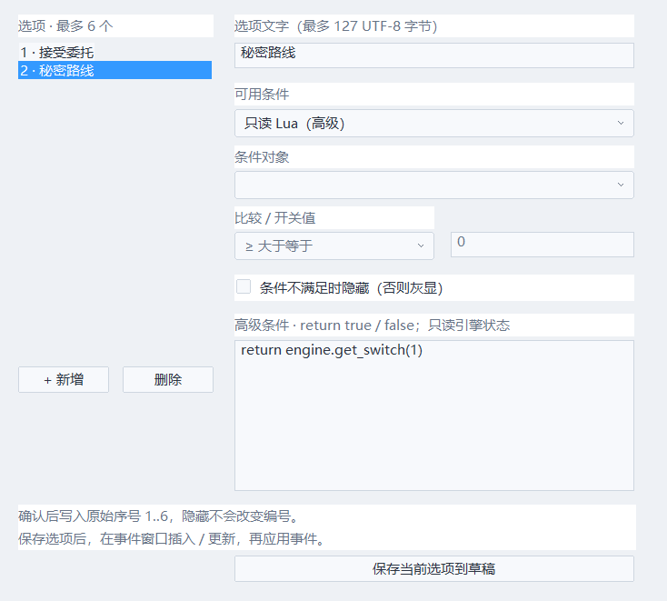
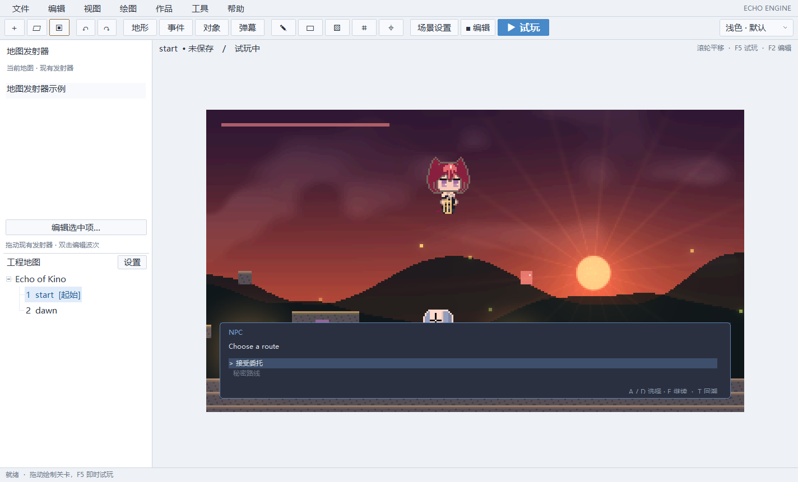

# 对话选项与条件分支

在事件编辑器选择「显示选项 / 条件选项」，设置提示正文、说话者和头像，选择结果变量，再打开「编辑选项与条件」。最多六项，每项文字最多127 UTF-8字节。保存选项到草稿后，在事件窗口插入或更新指令，再应用事件；Ctrl+S保存作品。选项不是另一个隐含脚本任务，而是原有事件的有界等待指令。

每项可选择始终可用、全局开关、变量六种比较，或高级只读Lua条件。条件不满足时默认灰显，也可勾选隐藏。条件在菜单打开时计算一次，结果写入快照；菜单期间改变条件值不改变已打开菜单，重新打开才重算。灰显项不能选，左右导航会跳过；如果全部不可用，只终止所属事件并显示故障，不锁死整场游戏。

默认A/D选择，E确认，采用作品配置的移动/确认键。按住不会连跳；提示尚未打完时先补全文字，松开再按才提交。提交把**原始选项序号1..6**写入指定变量，隐藏选项不会让编号变化。接着用普通「条件：变量」或只读Lua分支处理接受、拒绝、传送、奖励等；不给菜单本身隐藏的玩法副作用。

「选项分支NPC」预设生成选项、结果变量及普通条件分支。生成的object_lab示例也部署该NPC，可拆开修改。

高级条件示例，完整示例在scripts/dialogue_choice_condition.lua，复制到高级条件表单，不能作为启动Lua直接执行：

~~~lua
return engine.get_switch(1) and engine.get_variable(2) >= 3
~~~

必须恰好返回一个布尔值；不得修改WorldState、调用写API、挂起Lua栈或捕获持久状态。条件复用已有只读事件环境、指令预算、编译缓存、全量回滚和错误定位，错误包含地图/公共事件、页、指令和选项编号。修改定义在试玩边界开始新历史。

WorldState.dialogue保存choosing、六槽标签/原始编号/可用性、selected、resultVariable、previousNavigation和previousConfirm；事件等待、页、PC、控制权本来就进入快照。T恢复历史选择，R恢复世界和菜单的历史状态并独立移动角色；截断后仍可选择另一条分支。换页、消除、父任务取消、切图沿用所属对话的取消规则。

保存为ECHO_EVENTS_9，选择指令后附CHOICES元数据；继续读取v1–8。旧运行时不能读取新版本。结构检查拒绝空标签、非法数量/条件/比较/变量、截断及多余数据。

已验证30/60/120Hz、窗口最远处继续、禁用历史、按键边沿、灰显/隐藏编号、取消、Lua只读与错误定位、序列化及无C++稳态堆分配。姓名输入、选项取消键策略、文本本地化及完整UI编辑器仍待建设。

