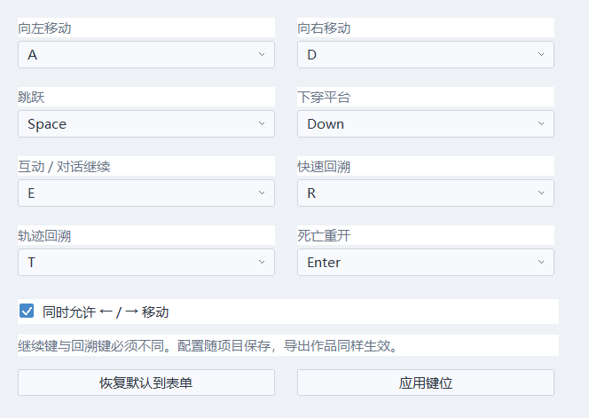
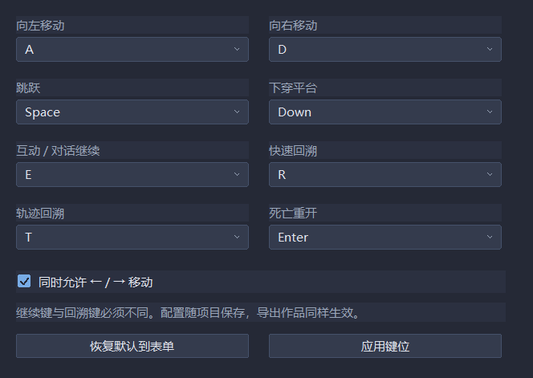

# 对话与作品键位

在「作品 → 键位设置」选择八项键盘动作，点击「应用键位」，再保存项目。默认 A/D 移动、Space 跳跃、Down 下穿、E 互动/对话继续、R 快速回溯、T 轨迹回溯、Enter 重开。可同时启用左右方向键移动。「恢复默认到表单」只修改草稿，点击应用才生效。配置保存到 project.echo，公开/加密导出的作品都会使用它。

同一个键不能对应两个动作；继续和回溯键尤其不能重复。启用方向键移动时，Left/Right 不能再分配给其他动作。冲突会拒绝整次应用，保留原配置。低速和判定显示键仍在「判定点 / 低速 / 采样」设置。当前为单键映射，不支持组合键、手柄或玩家独立设置文件。

对话每行一页。继续键第一次按下补全当前打字内容，松开再按进入下一页，最后一页结束后恢复行动。触发对话时按住的键不会直接跳过它；按住继续也不会连续翻页。提示会显示当前继续键和轨迹回溯键，关闭回溯后隐藏回溯提示。对话条目、页码、打字进度和确认边沿随快照恢复。

对话已经在同一次 OpenGL 呈现中绘制。头像和文字使用纯视觉栅格缓存，隐藏窗口只供排版；不再由独立可见窗口在交换画面后重绘。缓存不改变 WorldState。单次栅格上限64 MiB，头像缓存仍最多8张。已有最多六项的条件选项表单、灰显/隐藏、结果变量与只读Lua条件，见 [条件选项](DIALOGUE_CHOICES.md)。可换皮肤对话布局及姓名输入仍待建。

回溯结束已取消自动清弹；主动事件/脚本的分组清弹仍是独立指令。快速回溯结束的0.45秒保护仍保留。已确认近弹截停属于快速回溯：默认原判定扩大2逻辑像素、连续扫掠提前停止，见 [快速回溯规则](FAST_REWIND.md)。可改绑快速回溯到E，但继续键必须改用其他键。轨迹回溯没有近弹截停。

## 工程字段

`keyboard_bindings` 按顺序保存八个 Windows 虚拟键编号和方向键移动开关：

```text
keyboard_bindings=65 68 32 40 69 82 84 13 1
```

旧项目没有此字段时使用默认映射。非法编号、重复动作、额外字段均拒绝加载。实体键位是作品设置，逻辑输入及确认边沿由世界状态管理。F2/F5/F6 在编辑期间仍为编辑器快捷键，在试玩中若被绑定为游戏动作则让游戏动作优先。

## 验证

27_dialogue_input 验证默认E继续/改绑、冲突/序列化/工程重载，30/60/120 Hz 翻页边沿、关闭回溯及六秒最远恢复后继续，以及快速回溯结束保留附近弹幕。07_native_editor_gpu 验证原生键位表单、实际方向键开关点击、默认恢复、保存重载、浅深主题，并连续检查8个真实OpenGL前缓冲帧里的对话。截图不会额外补画对话窗口。




