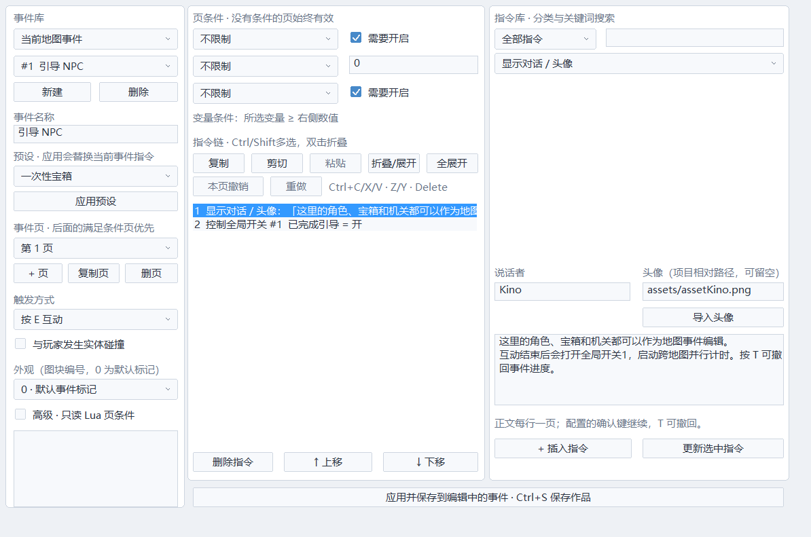
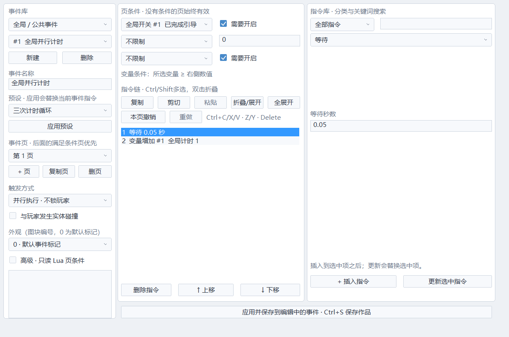
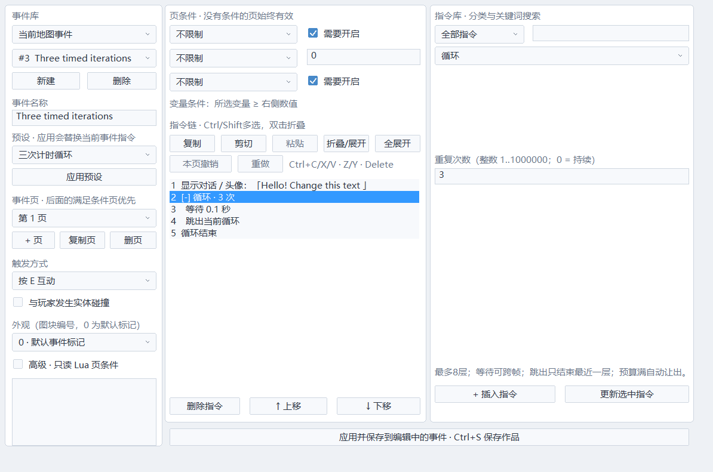
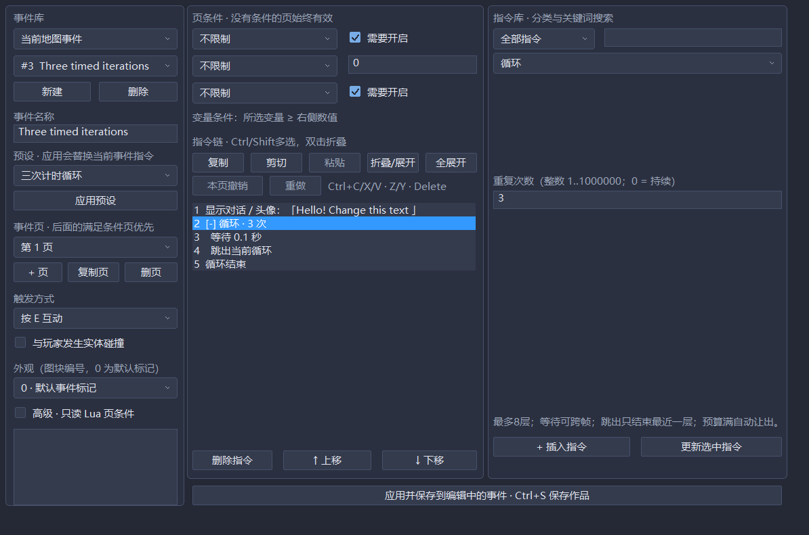
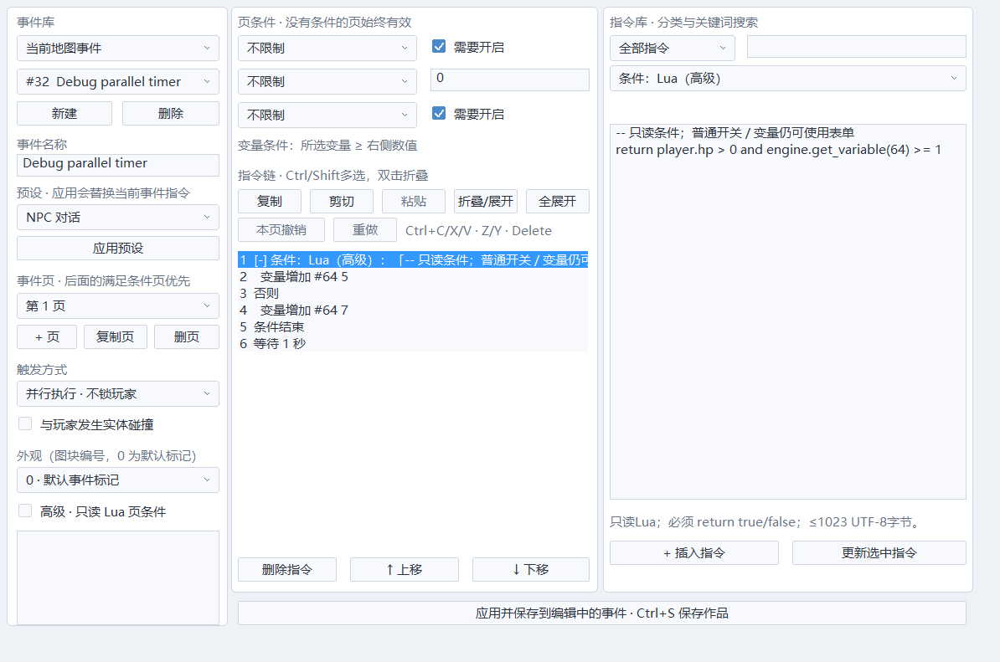
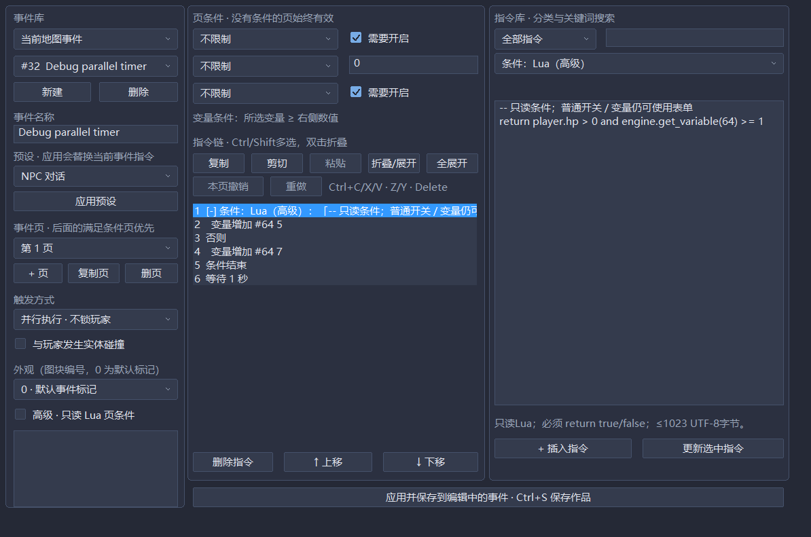
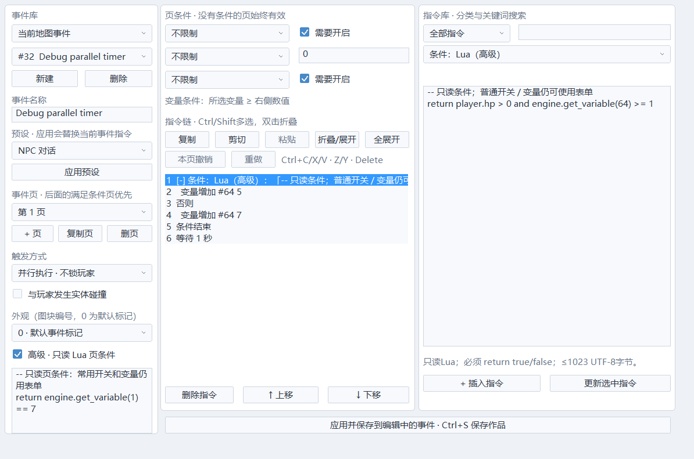

# 地图事件与全局事件

普通玩法使用事件页和指令表单，复杂行为再使用 Lua。事件定义是游戏项目资源，执行状态全部进入 WorldState。

## 地图上的基本操作

1. 点击左侧常驻图块缩略图，在地图拖动铺设。左栏选择前景／世界／后景，场景设置中调整自动碰撞。入口见 [工作区操作](WORKSPACE.md)。
2. 点击顶部「事件」，单击空地放置；拖动移动，右键删除。
3. 在事件工具下双击地图事件，或点击顶部「地图 / 全局事件」。
4. 设置名称、触发方式、实体碰撞及图块外观。
5. 中间是指令链。选中一项后右侧显示对应的参数表单。可插入、更新、删除、上移、下移。
6. 「应用」提交到当前编辑地图；Ctrl+S 保存作品。关闭事件窗口、保存或试玩前也会提交并验证草稿。
7. F5 试玩，E 互动/继续对话，T 撤回事件执行；F2 回编辑。

地图保存时一起保存 .echo.events；全局库保存到 events/common.echo。项目打开/地图切换会保存当前编辑内容并关闭旧事件窗口。与地图、数据库、资源等一起使用有界多文件保存事务及资源移动回滚日志。




## 触发方式与事件页

| 方式 | 行为 |
|---|---|
| 按 E 互动 | 按键边沿选择面前附近的一个地图事件，执行期间锁定玩家操作 |
| 玩家接触（兼容）/进入区域 | 进入时执行一次；快速穿过也能检测；前台忙碌时保留一个信号 |
| 离开区域 | 离开时执行一次；关闭区域交互不合成离开 |
| 持续接触 | 接触期间，上一轮链结束后再执行 |
| 自动执行 | 满足页条件就执行并锁定玩家；结束后下一步可重启，因此通常用开关切到空页 |
| 并行执行 | 与玩家同时执行；等待会让出帧，完成后自动从头开始 |

每事件最多4页。检查顺序从最后一页到第一页：最后一个满足条件的页生效。页条件可以组合全局开关、变量≥阈值、独立开关A/B/C/D。

页变化取消旧指令执行、等待、移动和本事件拥有的对话。被取消的公共调用会返回调用者，避免调用者永久等着一个已经改为并行的新页。没有满足条件的页，事件隐藏并关闭实体碰撞。

实体碰撞使用实际逻辑矩形；外观目前为图块或默认事件标记。NPC 独立精灵/动画数据库与复杂移动路线尚未实现。移动事件指令可选穿透或扫掠阻挡/沿墙滑动；路线时间继续消耗，没有导航、推人或挤压响应。接触采样、待触发标记和移动阻挡状态全部进快照，详见 [碰撞与区域事件](COLLISION_RULES.md)。

## 全局 / 公共事件

窗口左上切换到「全局 / 公共事件」。它们不用在地图放置，也不随地图切换重置。

- **仅被调用**：地图/其他公共事件用「调用公共事件」执行；调用者等待结束后继续。
- **自动执行**：条件满足后运行，锁定玩家。用全局开关切换条件以结束自动剧情。
- **并行执行**：后台计时、任务状态、昼夜逻辑等。地图切换保留指令游标及等待。
- 全局开关128个、整数变量64个；地图事件独立开关按地图和事件ID保存，全局事件也有自身独立开关。
- 公共调用会检查直接/间接等待环；错误调用记录错误并让调用者继续，不进入阻塞循环。
- 每个模拟子步最多256次解释器指令，单事件最多16次；48个运行槽轮转调度，调度游标也进快照。



## 当前指令

| 分类 | 表单命令 |
|---|---|
| 对话 | 正文、说话者、头像，每行一页；正文可用 `\V[1]` 引用变量1 |
| 时间 | 等待秒数、次数/持续循环、跳出当前循环 |
| 数据 | 开关开/关、独立开关A..D、设置整数变量、变量增加/减少 |
| 分支 | 开关条件、变量比较（≥、=、<、>、≤、≠）、否则、条件结束；可嵌套 |
| 地图 | 选择目标地图、出生点或指定坐标 |
| 音频 | 播放/停止BGM、选择SE及音量、BGM渐变时长与目标音量 |
| 环境 | 选择背景环境 |
| 事件 | 按指定时间移动本事件、暂时消除本事件、结束执行、调用公共事件 |

插入条件会自动建立「条件 → 否则 → 条件结束」，删除或上下移动条件时按整个分支操作；结构行不能单独删除或移出分支。分支未配对、无效参数或超出容量时，应用/保存会显示错误并保留草稿。暂时消除在重新进地图时重置；全局变量和独立开关保留，因此宝箱应使用独立开关换页。

开关与变量名称、备注、初始值在「命名数据库」编辑，事件条件与指令仍用稳定编号引用。事件PC/等待与当前值可在「试玩调试器」查看；步骤见 [AUTHORING.md](AUTHORING.md)。

正文变量在「显示对话」执行时解析并保存到快照；文字显示期间变量变化不会改掉已经显示的句子。文本最多1023 UTF-8字节，头像路径255字节，名称/说话者63字节。

## 示例工程

- 起始地图：引导NPC，结束对话打开全局开关1。
- 全局事件1：开关1开启时，「等待1秒 → 变量1增加1」，切图继续。
- 宝箱：显示正文 → 调用公共事件2 → 独立开关A开启。
- 公共事件2：变量2增加1 → 播放奖励音效。
- 宝箱第二页：条件为独立开关A开启，显示已经打开，不再领奖。
- 黎明地图：NPC显示变量1计时和跨图说明。

这些是项目数据，不写死在引擎入口里。「NPC / 宝箱 / 并行计时 / 地图传送 / 三次计时循环」预设可以应用到自己的事件。

## 快照和资源边界

WorldState保存全局开关/变量、9个独立开关库、地图/公共执行槽的页/PC/循环端点与次数/等待/移动/调用代次、交互边沿、前台锁、对话及轮转游标。事件位置/消除/外观/碰撞也在活动地图快照中。

每地图最多32事件、全局16事件、每事件4页、每页32指令。定义按实际数量分配，只在加载/编辑边界改变；试玩调用 setEvents 会清空旧历史。undo/redo同时保存地图放置和事件定义，每栈最多64步且约64MiB上限。

```lua
engine.set_switch(1, true)
engine.set_variable(2, 10)
local active = engine.get_switch(1)
local count = engine.get_variable(2)
```

Lua接口与表单使用同一份快照数据。API槽号从1开始。仍需使用快照持久状态，不能用Lua闭包当作无法恢复的计时器。

## 后续易用性

开关/变量/物品/单目标任务数据库、条件选项和当前页/PC/等待查看已有；还需建设角色完整生命周期、装备/道具效果、多目标任务、姓名输入、更多指令类别、移动路线/路径编辑、常用指令收藏、指令链正文查找、跨工程依赖迁移、逐指令断点与条件解释，以及更大的自动地形调色板。

这些是明确的下一批产品能力，不能用当前基础指令链代替完整 RPG Maker 产品。

## 玩家控制与公共子任务

「玩家控制权」提供预设和九项勾选许可，结束/取消自动释放本任务；父事件取消会结束它调用的公共子任务，独立全局任务继续。长按被禁止的按键需要松开再按。规则、时钟表、练习与实际表单见 [玩家控制权](PLAYER_CONTROL.md)。保存事件使用ECHO_EVENTS_10，继续读取1–9。

## 高级Lua指令

地图和公共事件均可插入“执行 Lua 脚本（高级）”；正文支持多行，单条≤1023 UTF-8字节。应用只编译，F5缓存全部定义；语法/运行错误定位到地图/事件/页/指令/行。该条失败全量回滚其WorldState写入，任务/子任务停止并释放控制，故障锁存进快照，换页/重开/回溯到故障前可重试。独立开关、所属控制许可和正式转场请求可由Lua调用；普通等待/对话继续使用指令。API、预算、上下文、例子和真实窗口见 [高级脚本扩展](SCRIPT_EXTENSIONS.md)。


## 循环与跳出循环

预设选择「三次计时循环」可生成“循环3次→等待1秒→变量1增加1→循环结束”，地图与公共事件都可用；替换变量操作为发射器、音效或Lua，即可制作自己的波次。该预设默认互动/仅被调用，每次触发执行三轮，可在表单修改触发和参数。

指令类型选择「循环」，填写整数重复次数：1–1000000；0表示持续循环。插入时自动生成「循环结束」。选中循环标题可成组上移、下移、删除；循环结束与否则不能单独插入或删除。结构错误、循环外的跳出和非整数次数会拒绝，保留原指令草稿。应用后进入地图/事件共用撤销，保存/导出沿用事件文件。

「跳出当前循环」只结束最近一层，直接到该层结束后；即使位于条件分支中，也跳过尚未执行的条件结束。最多8层嵌套、每页32条，条件与循环必须各自正确闭合。循环次数是进入时确定的值，内层每次由外层重新进入时重置。

例如无脚本制作三波弹幕：

1. 循环：3次。
2. 控制弹幕发射器：开启并重新开始。
3. 等待：0.8秒。
4. 控制弹幕发射器：关闭。
5. 等待：0.2秒。
6. 循环结束。

持续循环中可加入开关条件：开关开启→跳出，否则→等待。每个任务每模拟子步最多16条，全体最多256条，满预算自动让出；零等待持续循环也不会阻塞主线程，但会耗用事件预算。调试器显示循环层数、当前层剩余次数或持续，以及预算让出计数。推荐时间逻辑明确加入等待，避免高速重复改变变量或音频。

PC、固定8槽的循环端点/剩余次数、等待和公共调用全部在WorldState里。换页、取消、消除、离图、任务完成或Lua故障结束对应循环；公共子任务有自己的循环栈，父取消会清子任务。T/R恢复当时进度，不重置计数。高级操作可在循环体插入「执行Lua脚本」；Lua使用同一共享步预算和故障回滚，跨帧计数不能藏在Lua闭包里。外部命名函数和脚本控制跳转API仍待建。

事件格式现在保存ECHO_EVENTS_10，读取v1–9；旧v5脚本无改义。循环使用v6新增的操作码，v1–5不接受循环；v7新增指令链Lua条件，v1–6不接受Lua条件；未添加新版指令的旧文件也会在保存时升级。新版文件需要当前运行时。






## 条件：Lua（高级）

普通判断继续用开关或变量表单。组合判断可选「条件：Lua（高级）」，默认填入“玩家存活且变量1≥3”的示例；正文≤1023个UTF-8字节，可多行注释和局部计算。插入自动生成“条件→否则→条件结束”，成组移动/删除、应用前编译、保存和统一撤销与普通条件相同。语法错误显示地图/事件/页/指令/行号，失败保留已应用定义。

~~~lua
-- 两项条件同时满足
local ready = engine.get_variable(1) >= 3
return player.hp > 0 and ready and not engine.get_self_switch("A")
~~~

只返回一个true或false；false走否则，不是错误。没有返回、返回nil/数字/字符串/表或多个结果均为运行错误，不采用Lua“真值”隐式转换。返回值不跨帧缓存，调用一次后直接推进快照内的PC；读的是当时WorldState，所以恢复后走该时刻分支。

允许读取jump/rewind/boss/player/music、persistent或engine.state数值槽；engine只提供get_switch/get_variable/get_self_switch/event_context/object_valid/collision_pair。math/string与基础assert/error/type等纯计算工具可用；随机、发射、音频、传送、对象修改等API不可用。所有世界代理写入立即报错；额外完整备份/比对/恢复保证条件无WorldState副作用。需要修改状态时，将「执行Lua脚本」放在选定分支里，不能在判断正文顺便写变量。

条件和执行脚本共同使用每模拟子步32次调用/100000条VM指令与8MiB Lua堆。条件错误/超预算停止所属任务与公共子任务，清循环/释放控制，故障锁存入快照；不会每帧重试。原生编译只验证语法，返回类型和只读权限在试玩检查。此入口用于指令链；外部函数/模块、绑定参数、逐指令断点仍待建。





## 高级事件页条件

事件页左下角勾选「高级 · 只读 Lua 页条件」，填写返回一个布尔值的多行正文。普通开关、变量、独立开关照常使用表单；它们全部满足后才运行Lua。未勾选时不编译、不执行，保留正文以便下次启用。正文最多1023个UTF-8字节，应用先编译，错误保留草稿及之前已应用的定义。可以复制页、撤销/重做并随工程保存。

~~~lua
-- 例如：玩家仍存活，且已经取得指定道具所对应的开关
return player.hp > 0 and engine.get_switch(1)
~~~

最后面的满足条件页优先；false继续检查前面的页。页切换取消旧指令进度、公共子任务、对话和控制许可，然后根据新页触发方式执行。每个带Lua条件的事件每模拟子步只在首次查询时选页，互动检测/公共调用/调度复用结果；同子步中其他事件修改条件数据，在下一子步重新判断。此缓存仅存在本次调用，不在Lua侧跨帧保存。

页条件使用与指令条件相同的只读环境，只能读取数值状态和查询API，不提供随机、修改变量、修改代理、对象创建或文件访问。必须恰好返回一个boolean，不能返回1或nil。engine.event_context()返回地图编号、是否公共、事件ID、页号和0（没有对应指令）。用例可复制[scripts/event_page_condition.lua](../scripts/event_page_condition.lua)，不要加入启动scripts。

编译错误定位到地图/公共事件、事件、页条件和源码行；运行错误停止整个所属事件、公共子任务，释放对话和控制，并隐藏该事件碰撞与外观。不能在错误时退到前面的宝箱奖励页。EventRunner.pageConditionFault锁存出错页，进入快照，不每帧重试；重新开始、重新加载定义或回溯到错误前可恢复；地图事件离图重入也清除其故障，独立公共事件的故障随全局任务保留。任务取消不清掉此故障；明确地图/游戏生命周期取消才清除。最近错误文本属于诊断，故障真实状态以恢复后的runner为准。

每模拟子步与指令Lua共享32次调用、100000条VM指令、8MiB Lua堆。开始查询前预算已满时保留原页和任务进度，本次不执行旧页指令；公平调度在后续子步重新尝试，EventState.pageConditionDeferrals显示累计延期次数。已经开始运行的非法/超预算脚本仍按故障处理。预算延期期间输入按已有事件输入规则采样，未提供无限输入队列。

保存格式ECHO_EVENTS_10：每页头部后增加PAGE_CONDITION启用标记和带引号的正文，继续读取1–9并默认禁用。旧文件在保存时升级，新文件需当前运行时。定义和编译缓存不可变；页选择、执行进度、故障、延期计数进WorldState。读取历史不会再次执行Lua，截断后继续正向时重新查询。

原生窗口的浅/深预览及实际试玩见[验证记录](VALIDATION.md)。外部函数模块、表达式绑定、编辑补全和点击错误跳行仍待建。



[深色预览](previews/event-page-condition-dark.png)

对话选择指令及开关/变量/只读Lua条件、灰显/隐藏、结果变量与预设见 [条件选项](DIALOGUE_CHOICES.md)。v9在选择指令后追加CHOICES行及选项数据，v8页条件定义继续兼容。

## 物品与任务指令

游戏数据库定义物品/单目标任务后，事件里按名称选择增减数量、持有条件、任务状态、增减进度、状态条件、进度条件。条件插入自动生成否则/结束；增减操作可选命名变量接收成功或失败结果。ID不随改名变化；未知条件为false，未知变更记录失败，不自动选择另一项。格式v10新增六个操作码，v1–9不接受这些新操作码。容量、语义、Lua和无脚本示例见 [物品与任务](INVENTORY_QUESTS.md)。

## 指令库与成组编辑

右侧分类/关键词实时筛选，选择原指令时自动显示其真实类型；中间Ctrl/Shift多选、复制/剪切/粘贴、双击结构折叠以及有界本页撤销/重做。标题/否则/结束会按完整块处理，复制中的跳出带上所需循环；折叠后实际PC不变。Lua在候选提交前编译，失败不改指令、剪贴板或撤销。规则、预算、高级正文与工程内跨页/事件复制见 [事件成组编辑](EVENT_EDITING.md)。格式仍v10，不新增玩法字段。
