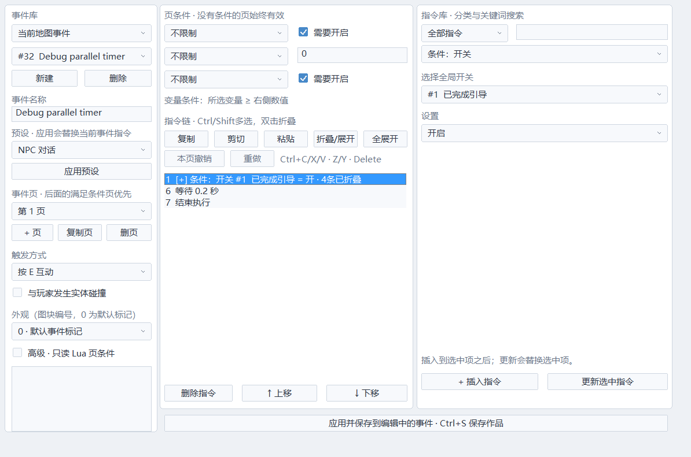
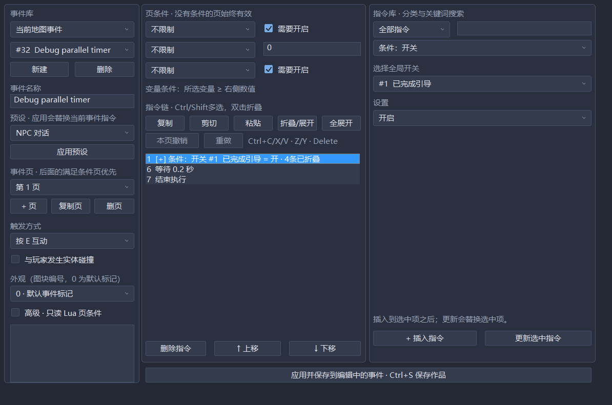

# 事件指令库、成组编辑与折叠

打开地图事件或公共事件。在右侧指令库选择「对话与选项、数据与任务、流程与条件、地图与事件、弹幕与战斗、音乐与音效、玩家控制、高级脚本」，或用「全部指令」。关键词实时筛选，支持中文名称、英文别名及空格分隔的多个词，例如「Lua 条件」「BGM 渐弱」。最多64个字符；没有匹配时不能插入旧类型。公共事件不提供仅用于地图事件的移动/消除指令。

选择已存在的指令时，表单始终显示该指令本身。如果当前分类/关键词把它隐藏，指令库自动回到全部、清空搜索；不把原指令偷偷改成筛选后的第一种类型。

## 多选与复制

- 单击选择；Ctrl单击选择不连续指令；Shift选择一段；列表获得焦点时Ctrl+A全选。
- 「复制／剪切／粘贴」或Ctrl+C/X/V操作本工程的指令剪贴板。普通指令按原始顺序复制，参数、对话、头像、条件选项和高级Lua正文都深拷贝。
- 选中条件/循环标题或否则/结束标记，会带上完整结构。复制的内容若包含「跳出当前循环」，也会带上所需的最近循环，避免变成孤立跳出。
- 可在同工程的其他页、事件、地图或公共事件粘贴；独立开关在目的事件中解释，其他开关/变量、地图、模板、发射器、物品/任务等仍引用原工程ID。不会克隆被引用资源。
- 剪贴板最多32条完整指令；每条仍遵守6个选项和已有文本上限。切换工程/重新载入时清空，防止同一数字在另一工程指向不同对象；不读取系统剪贴板，也不用于跨工程迁移。
- 粘贴在选中指令后；没有选择时追加。选中折叠标题时，插入/粘贴到整块之后，避免写进看不见的分支。
- 多选删除可不连续；上/下移动要求连续的完整组，只跨相邻同级指令/结构块，不跨父级或否则边界。无合法位置时保持原组。

同时选中多条时不提供模糊的参数更新；先选择一条再改表单。否则和结束标记由结构操作维护。

## 分支折叠

双击条件/循环或点「折叠/展开」。在块内选中普通指令时，该按钮折叠最近父块；「全展开」恢复整个页。左侧行号始终是实际指令位置，折叠标题显示隐藏条数，后面的指令不会因可见行变少而被误删或编辑。

折叠只隐藏编辑器行。全部内容仍参与保存、编译、执行、复制与结构验证；不会隐藏运行内容或写入WorldState。切页/换事件重置折叠；改动命令结构也展开，以免旧索引指向新块。

## 两层撤销与错误

「本页撤销／重做」或列表焦点下Ctrl+Z/Y恢复尚未应用的命令操作；一次复制后粘贴、剪切、成组删除或移动是一项。最多16个状态，深层页/指令/选项资料与预留容器计入8MiB预算，超限淘汰最旧项，新的修改清空重做。候选和提交副本有额外的有界临时内存；该预算不是整个编辑器进程上限。切页/换事件清空本页历史，剪贴板仍保留。

点击「应用」后仍以一项地图/事件/弹幕共享历史提交；主地图Ctrl+Z/Y或已有撤销命令恢复已应用资料。Ctrl+S把当前事件应用后通过作品保存事务写盘。普通编辑字段中的Ctrl+C/X/V/Z/Y继续是文字编辑行为，不被指令列表接管。

候选先通过数量、公共事件能力、条件/循环结构和Lua语法验证；失败保留原命令、剪贴板及撤销/重做，报错定位到页/指令。Lua在插入/更新/粘贴时提前编译，绝不预执行玩法；应用和试玩仍继续进行整体检查。缺失的动态Lua ID及脚本运行错误按原运行时规则处理。

作者的选择、搜索、折叠、剪贴板和草稿历史不进玩法快照。真正执行进度仍在WorldState；关闭历史也可正常执行编辑出来的指令。作品定义修改沿用既有试玩控制边界，不能让旧历史读取新的程序。

原生多选按[Microsoft的多选列表语义](https://learn.microsoft.com/en-us/windows/win32/controls/lb-getcursel)读取全部选择，单个焦点行不等于整组选择。

## 例子与高级入口

[任务练习室](../projects/progression_lab/README.md)的委托人有嵌套任务状态/持有物品条件，可折叠查看主流程；复制到同工程新事件会继续引用回声钥匙和任务。先按目的调整独立开关，再应用和试玩。

「高级脚本」分类中的执行Lua、只读Lua条件与条件选项正文沿用[高级脚本扩展](SCRIPT_EXTENSIONS.md)，复制/粘贴保留正文，跨帧数据仍只能放快照持久槽。此工具不提供Lua协程等待，也不能用搜索/折叠绕过每页32条或脚本预算。

指令收藏、跨工程依赖迁移、通用移动路线、镜头/天气渐变/动画命令及剧情/Boss预设仍待建设，W02整体还未完成。

## 原生界面

