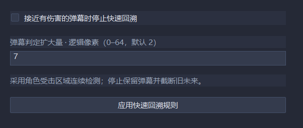

# 快速回溯近弹截停

这是现有的快速回溯，默认按住 R；可在「作品 → 键位设置」改为 E，继续键须使用其他键。角色仍走按下瞬间锁定的 A→B 直线，世界恢复过去；轨迹回溯 T 仍按真实历史轨迹倒退。

在「作品 → 快速回溯规则」启用“接近有伤害的弹幕时停止快速回溯”，默认开启。扩大量默认2逻辑像素，可设0–64的小数。应用后保存项目，重开/导出采用同一规则；旧项目缺少这些字段时使用开启/+2默认值。

检测使用角色的实际受击区域，包括整角色、动画框、自定义多区域、形状、伤害过滤和低速条件；地形实体框与受击区域仍分开。只在近弹查询中把弹幕圆半径或方形半尺寸增加指定值，绝不改写 bullet.hitR，也不扩大正常受伤判定。近弹检测使用连续相对扫掠，普通受击设为“当前帧重合”也不会令快速移动漏检；扩大的边界相切也停止。碰撞矩阵禁用玩家/弹幕时不检查普通弹幕。

5倍游标逐个检查经过的历史帧，避免漏掉仅存在一帧的弹幕。通过稳定弹ID匹配上一恢复世界的位置，再进行相对运动检测；新增/重新出现的弹幕按恢复位置检查。最早危险与地形、琥珀及Boss接触竞争。停止位置预留0.001逻辑像素间距；恢复快照已经在起点重合时原地停止，不能保证任何过去快照都没有重合。弹幕两帧间曲线以相对线段近似，与现有连续碰撞策略一致。

低倍率下还未跨游标的恢复/新落点也会提交到当前历史槽。摄像机在新分支立即跟随。停止后截断当前游标之后的旧未来并替换当前槽，保留全部恢复弹幕（含px/py），不扣血、不触发普通弹幕命中钩子。保留快速回溯结束的0.45秒保护；按住键不会自动重复启动，松开后才能重新开始。无伤装饰弹不截停；琥珀仍走原实体制动规则。关闭近弹规则允许快速回溯穿过普通弹幕，结束仍不自动清弹。事件/脚本主动清弹指令是另一项功能。

## 高级脚本与保存

~~~lua
rewind.fast_stop_near_bullets = true
rewind.fast_bullet_margin = 2.0
-- 比如事件脚本在特定场景允许穿过普通弹幕：
-- rewind.fast_stop_near_bullets = false
~~~

配置直接位于WorldState.rewind，恢复历史时也恢复当时的开关/扩大量。启动脚本及事件“执行Lua”都可访问；无效扩大量、NaN或无限数拒绝写入。实例见 [scripts/rewind.lua](../scripts/rewind.lua)。

工程字段：

~~~text
rewind_fast_stop_near_bullets=1
rewind_fast_bullet_margin=2.000000
~~~

每子段最多2048发，固定32 KiB位置/半径样本，排序和二分匹配为有界O(N log N)。没有每弹扫描全池的平方匹配，没有模拟步C++堆分配。额外配置使完整快照变为498576字节；预算仍通过sizeof(WorldState)自动计算。长窗口/高记录频率提高恢复工作量，512MiB默认预算仍无法保留完整30秒/120Hz。

## 验证

28_fast_rewind_guard 覆盖30/60/120Hz、六秒最远T/关闭近弹后的R继续、截断/锁存/不扣血/不清弹/px与py、移动弹和单帧弹、整角色/多区域、Overlap及相切规则、无伤弹、矩阵、琥珀、历史关闭、Lua及配置恢复。2048发使用大量相同哈希桶ID，在120Hz完整六秒快速回溯中检查零C++堆分配并记录P95/P99/最慢外步。07原生验证表单、开关点击、范围错误保留配置、保存并用真实工程加载器重载，以及浅/深主题。

以下截图显示可关闭并自定义为7的例子，默认值为开启/+2。

