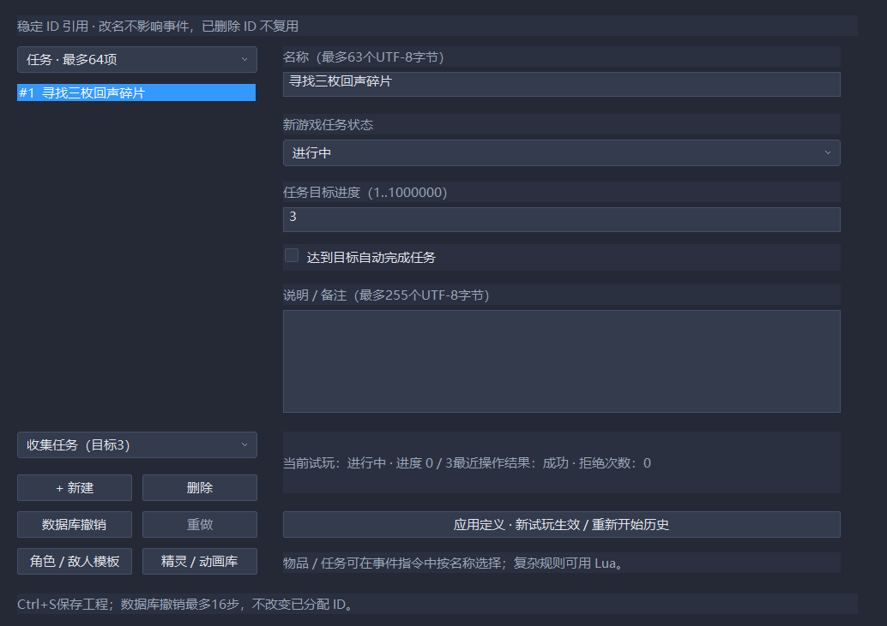
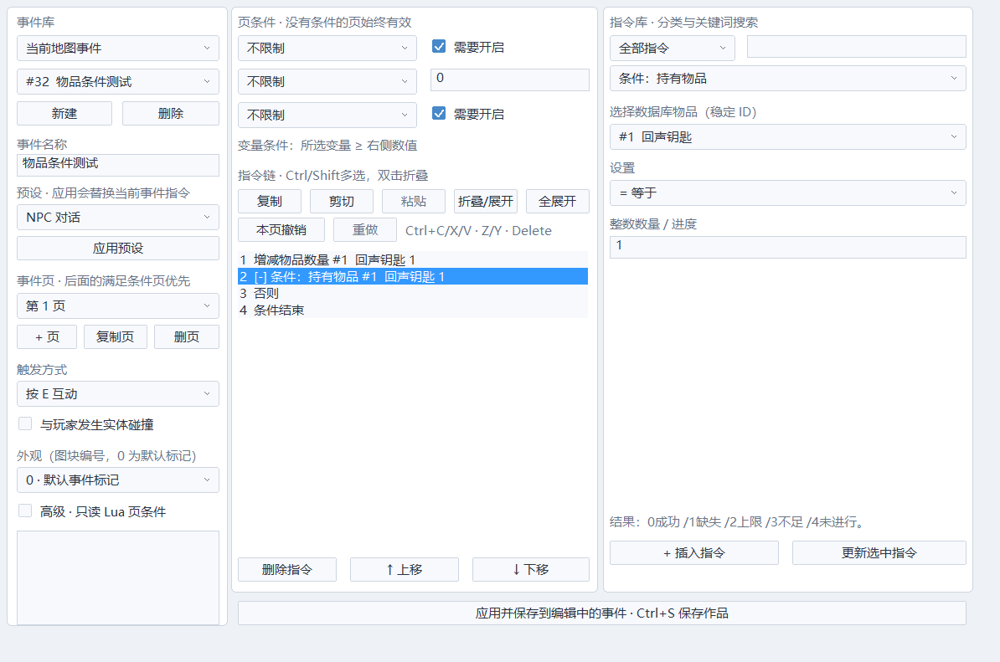

# 物品、背包数量与任务数据库

入口：「作品 → 游戏数据库」。分类包含开关、变量、物品与任务，并可打开角色/敌人模板和动画库。名称用于选择，稳定ID用于引用；改名不会把事件指向另一项，删除/撤销也不复用已分配的ID。

## 常用制作

1. 在「物品」选择「唯一钥匙」或「普通物品」预设，再点「新建」。填写名称、初始数量、持有上限和说明，应用后Ctrl+S保存。
2. 在「任务」选择默认、收集或手动结算预设。设置目标、初始状态、是否达到目标自动完成；应用会重新开始试玩历史。
3. 事件指令提供「增减物品数量」「条件：持有物品」「设置任务状态」「增加任务进度」「条件：任务状态」「条件：任务进度」。目标从名称列表选择，不用记开关编号。
4. 物品增减和任务进度可选一个命名变量接收结果，再用普通变量条件处理数量不足、达到上限等情况。
5. 数据库支持16步撤销/重做，预留与定义副本合计有界约4MiB；引用中的物品/任务会阻止删除，并指出地图/事件/页/指令。Lua动态ID不作静态反查，需由脚本处理。

每项目最多64种物品、64项任务，各自ID空间1..1000000；上限/目标1..1000000。运行数量与任务记录使用固定容量，不在模拟步扩容。持有上限是每种物品的数量上限；尚无格子背包、负重、装备、可用道具效果或玩家背包菜单。

## 行为规则

增减数量是整数操作。超过持有上限或减少到负数时，保持原数量，返回失败结果。任务状态分为未接受、进行中、已完成、失败。只有进行中的任务能增减进度，进度限制在0..目标；默认达到目标自动完成，关闭该选项可以先对话再手动结算。

重新接受失败/已完成的任务时进度清零；对进行中任务重复设置「进行中」保持进度。「未接受」重置进度；显式「已完成」将进度置为目标；失败保留当时进度。物品发放和任务完成是独立指令，奖励条件和失败分支由制作者设置，并不自动保证多条指令组成奖励事务。

结果码供变量条件和高级脚本使用：

| 结果 | 含义 |
|---|---|
| 0 | 成功 |
| 1 | 定义不存在 |
| 2 | 达到物品持有上限 |
| 3 | 物品数量不足 |
| 4 | 任务不在进行中 |

数据库可查看当前试玩的数量/进度和最近结果。项目检查能定位正式指令中的缺失ID。定义修改、撤销/重做是控制边界，会重开历史；输入错误或删除被引用项时保留原定义和当前世界。

## 回溯与保存范围

WorldState.progression保存全部物品ID/数量/上限、任务ID/状态/进度/目标/自动完成策略，以及失败次数和最近结果。T全量恢复，R恢复世界进度、玩家仍走新直线；截断后按照该分支继续。跨地图保留全局数量和任务，关闭历史时也正常运行。

项目定义保存ECHO_DATABASE_2，兼容v1命名开关/变量；旧工程默认没有物品或任务。事件保存ECHO_EVENTS_10，读取v1–9；旧版本拒绝新指令码。项目文件保存的是定义和新游戏初始值，玩家进度存档仍待建设。当前任务为单目标进度，任务依赖图、多目标、奖励事务、任务日志/追踪界面与完整物品系统仍待扩展，不能把整个W01/W08标为完成。

## 高级Lua

~~~lua
local item = engine.get_item(1) -- 缺失ID返回nil；表是临时副本
if item and item.count < item.limit then
    local result = engine.change_item(1, 1)
    engine.state[10] = result -- 跨帧数据在C++快照槽中
end

local task = engine.get_quest(1)
if task and task.status == 1 then
    engine.add_quest_progress(1, 1)
end
-- engine.set_quest_status(1, 1) 接受，2强制完成，3失败，0重置
~~~

get_item_count(id)返回数量或nil；get_item返回{id,count,limit}，get_quest返回{id,status,progress,target,auto_complete}。两种查询可用于只读Lua条件，改返回表不改世界。change_item/set_quest_status/add_quest_progress返回上面的结果码；ID需是1..1000000的整数，数量/进度增量为±1000000内整数。只读条件不能调用写接口，类型错误报错，事件Lua整条命令失败时全量回滚。

无需把数据藏在闭包或自行实现on_snapshot。示例脚本为scripts/progression.lua，默认不在启动脚本列表；常规任务可以完全用表单和指令链制作。

## 示例与界面

无需脚本的完整领取/拾取/交付链见 [任务练习室](../projects/progression_lab/README.md)。数据库序列化上限256KiB；覆盖满容量转义文本的保存/载入，避免写出自身无法读取的文件。

