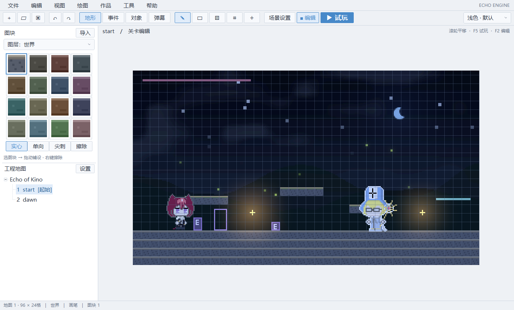

# 保留原图像素与调试静音

默认像素显示保留原图纹理。示例Kino的56×56帧按56×56虚拟画布像素绘制，Aster的48×48帧按48×48绘制，**不先缩成19×19或24×24**。窗口只以整数倍最近邻放大320×180画布。实际贴图文件没有重采样或改写。

当前pixelsPerUnit=0.25，因此一图片像素对应4逻辑像素。示例player_width/player_height=224、boss_width/boss_height=192，保持图片像素与画布1:1；锚点偏移另行设置以维持角色中心和脚底。Kino/Boss的玩法碰撞尺寸不由这两个贴图显示尺寸决定，物理、判定、快照仍用原来的浮点逻辑状态。

在「作品 → 应用像素清晰预设」恢复最近邻贴图、整数最近邻画布放大、AA关闭与crisp摄像机。它只改表现配置，不修改世界坐标或清空历史；Ctrl+S保存。作者仍可主动选择其他过滤/AA。该预设不擅自改已有动画的锚点或判定框。

动画编辑器的「原像素1:1」把所选动画倍率设为4逻辑px/图片px并应用当前动画属性。动画初始倍率已经是4。预览采用整数倍放大，大帧超过预览区域时裁切，不自动缩小破坏像素；示例动画已移除原来的1.375/.75倍率。

「工具 → 调试时静音BGM」默认勾选。偏好保存到项目本地.echo/workspace.echo（v2；兼容v1默认静音），不进入WorldState或作品配置，也不打包进发布资源。仅混音输出的BGM增益置零，已经排队的音乐立即清除；音乐逻辑时间、循环点、渐变和回溯状态照常运行，SE保留。用户在音频编辑器主动点音乐预览时可以试听；自动验证和smoke仍静音BGM。发布作品正常播放项目设置的音乐。

原生GPU验证逐一比较Kino帧的全部不透明源像素，再比较320×180画布与真实GL_FRONT整数倍窗口输出，确认没有丢失源像素、混色或相邻像素重影；过滤测试关闭背景光照来隔离采样，正常场景仍可启用环境效果。

