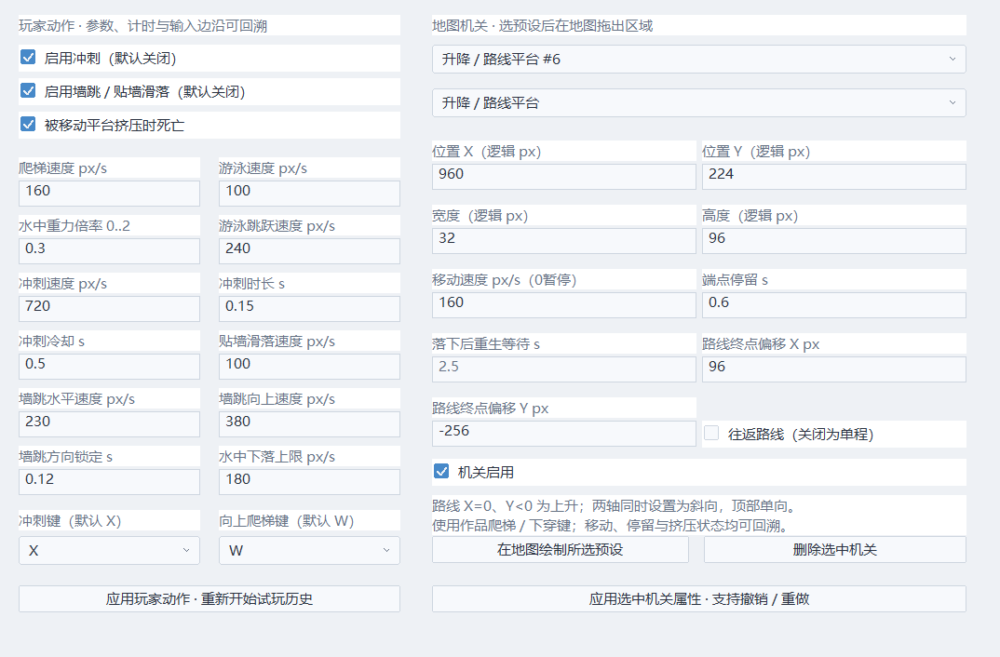
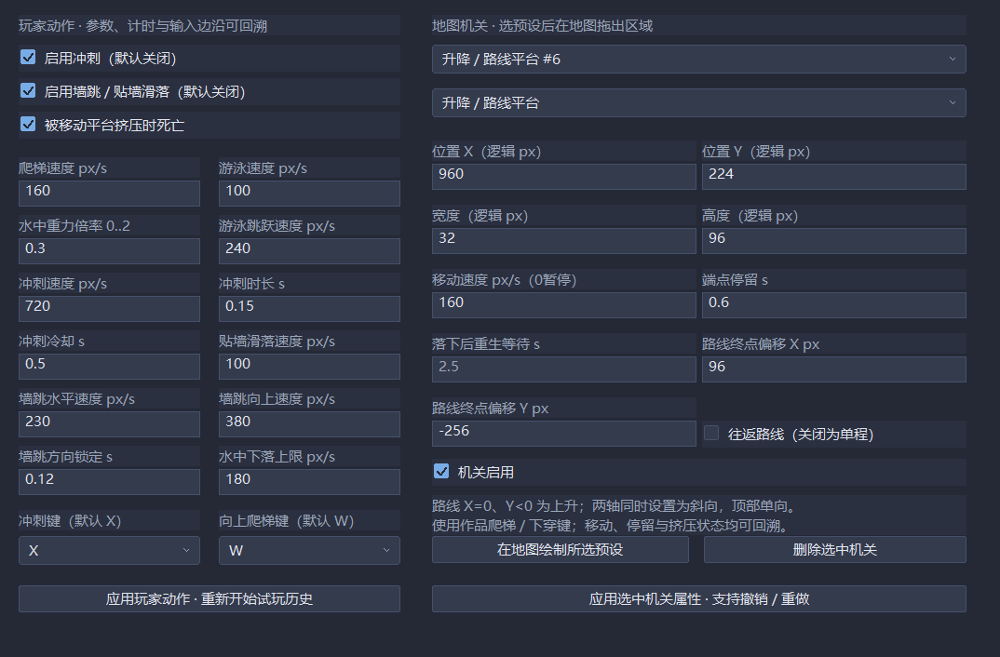

# 平台动作与机关预设

入口：「作品 → 平台动作 / 机关预设」。左侧设置角色动作，右侧选择地图机关。选择预设，点「在地图绘制」，在画布拖出区域；从左栏选择机关，或双击区域打开属性。右键删除；地图部署/拖动/属性支持撤销与重做，稳定ID不会因撤销而重新分配。每地图固定64个机关槽，ID最多100万，耗尽时明确报错。绘制使用预设默认参数，选中后在表单修改速度、延迟等并应用，Ctrl+S保存工程。

| 预设 | 规则 |
|---|---|
| 梯子 | 默认W向上、作品下穿键向下；松开挂梯，跳跃或左右移动离开；实体地形仍阻挡攀爬 |
| 水域 | 按可调游泳速度、重力倍率与下落上限行动；按跳跃可向上游，不依赖地面支撑 |
| 传送带 | 顶部单向支撑；速度可正可负，额外携带位移仍做扫掠，遇墙止步 |
| 弹簧 | 落在顶部自动向上弹射；弹射速度可调，单次接触只发一次跳跃音效，随后沿角色跳跃重力规则运动 |
| 升降 / 路线平台 | 默认向上192逻辑像素；终点偏移X/Y可做水平、竖向或斜向路线，按逻辑px/s移动，两端可停留；可往返或单程，单程抵达后仍支撑角色，速度0暂停路线与停留 |
| 落下平台 | 连续站立达到延迟后坠落；离开前重置预警计时，开始坠落后继续；离开地图下界后隐藏，等待后复位，不以复位瞬移携带角色 |

梯子/水域使用Player↔Trigger矩阵，支撑机关使用Player↔Terrain。事件移动可落在机关单向顶部；普通对象可落地并按模板选择乘坐、弹簧弹射、传送带和挤压策略，见 [对象乘坐](OBJECTS.md#随平台移动与挤压)；弹幕选择碰撞模式2时按相对运动检测这些顶部。单向顶部不阻断R直线，与原有单向地形规则保持一致。

墙跳与冲刺默认关闭。墙跳包含贴墙滑落、向上/向外速度及短暂方向锁定；冲刺默认X，水平冲刺、可调速度/时长/冷却，一次空中使用，落地恢复；持续按住不会重复。冲刺不会自动免伤，移动仍使用地形/实体连续扫掠。向上爬梯与冲刺键在此表单选择，动作许可与现有移动/跳跃权限协调，事件禁止动作期间按住需释放后重新触发。

升降平台顶部按角色与平台的相对运动扫掠，快速上升可接住上方角色，不能从下面附着；下穿期间不接住。旧移动平台携带与侧推均查询阻挡；被平台推向墙、天花板或横向地图边界时可选择死亡或非致命脱离。向下移动的支撑遇到地面会留下角色，不从脚下造成挤压死亡。死亡进入显式Hit：开启回溯可T撤回，关闭回溯等待重开。完整凹角脱困、所有动态体统一挤压、动态体统一处理及多节点路线仍需扩展，不能因此把R04/W03所有碰撞边界关闭。

WorldState.mobility保存全部动作参数与附加键位；KinoState保存爬梯/水域、稳定接触ID、冲刺剩余/冷却/方向/空中许可/按键边沿、墙跳方向锁定和挤压结果；LevelState.features保存定义及当前位置、上一位置、阶段、速度、延迟/重生/冷却计时。路线终点偏移、往返开关、进度、方向与端点停留计时也进快照。所有数据完整快照，R的新空间落点重新查支撑与水域/梯子接触，T原样恢复。

高级入口无需另外持久化Lua协程：

~~~lua
mobility.dashEnabled = true
mobility.wallJumpEnabled = true
mobility.dashSpeed = 720
mobility.waterFallSpeed = 180
engine.configure_platform(1, {enabled=true, speed=650, delay=0.2})
local f = engine.get_platform(1)
if f and f.stage == 1 then engine.state[1] = f.elapsed end
~~~

ID属于当前地图，表单显示；不存在时get_platform返回nil，configure_platform报错。查询返回临时副本，修改它不修改世界。mobility代理与configure_platform会校验范围，事件Lua失败沿用全量回滚；只读条件可以查询机关与mobility，但不能写入。复杂冲刺规则可用player.airDashAvailable和on_key_press的Dash动作，跨帧状态仍放engine.state。示例在scripts/mobility.lua，默认没有自动加入启动脚本列表。

地图保存ECHO_LEVEL_11，读取v1–9默认没有新机关，v10保留原五类机关并补默认路线字段。工程player_mobility保存参数；保存工程只写定义，玩家进度存档仍待建设。跨地图回溯能恢复当前地图机关；离开再进入恢复地图定义，非活动地图机关持久策略属于W06后续建设。

CTest30覆盖各机制、薄墙冲刺、方向锁定、挤压两分支、格式/ID/编辑撤销、Lua、禁用历史、30/60/120Hz完整六秒最远T/R再继续及稳态零C++堆分配。原生07验证六类绘制与路线参数、实际表单、保存、参数拒绝、浅/深主题；练习室生成器已部署全部六类机关并启用可选动作。

## 升降平台制作

1. 选择「升降 / 路线平台」并在地图拖出平台区域，选中后打开属性。
2. 设置终点偏移：例如X=0、Y=-192为上升，X=256、Y=0为水平，两个轴同时非零为斜向。拖动平台会连同路线起点和终点一起移动。
3. 设置移动速度和端点停留秒数；勾选往返则两端停留并返回，关闭则到终点保持支撑。不同机关不使用的参数会禁用。
4. 应用属性后地图显示点线与终点。F5试玩，Ctrl+S保存。

路线每次在端点转向，过量子步时间继续用于停留或下一段。最短长度1px，速度0–4000px/s，端点停留0–30秒，偏移各轴±8192；每图仍与其他机关共用64槽。单向平台路线允许经过地形，路线本体不会绕路/停机，但携带玩家会检测阻挡并执行挤压策略。顶点单程不隐藏。多节点、触发式启停、实体侧壁推人、箱体叠放、统一动态体及离图机关持久化仍待建设。

~~~lua
-- 仅用于当前地图的升降平台ID。
engine.configure_platform(6, {
    speed=160, travel_x=96, travel_y=-256, delay=0.6, repeat_route=true
})
local p = engine.get_platform(6)
if p then engine.state[2] = p.progress end
~~~

高级接口提供travel_x/travel_y/repeat_route参数，以及progress/direction查询。运行中修改路线偏移会重定位运行时起点以保留当前平台位置与进度，避免瞬移携带角色；不改编辑器定义。速度0冻结路线，重新启用往返可从完成的单程端点继续；运行中关闭往返则在当前行进方向的下一端点停止。无效参数不提交，事件错误仍按全量回滚处理。Lua接口不提供任意写入progress或direction，恢复由快照负责。

本轮验收：31_lift_routes验证竖向/斜向/单程/停留、快速相对接触、下穿/矩阵、向下遇地面脱离、子步到端点再返回时的天花板挤压、禁用/开启回溯的Hit恢复、v10迁移/v11保存、Lua修改保持位置、完整六秒各Hz最远T/R再继续，以及零C++堆分配。升降轮Release完整31/31通过，Debug定向30/31通过；当前新增普通对象乘坐见32与 [对象](OBJECTS.md#随平台移动与挤压)，未声明完整Debug回归。

可直接打开 [平台练习室工程](../projects/platform_lab/project.echo)，六类机关及乘坐升降平台的NPC均已部署；教程见 [工程说明](../projects/platform_lab/README.md)。
