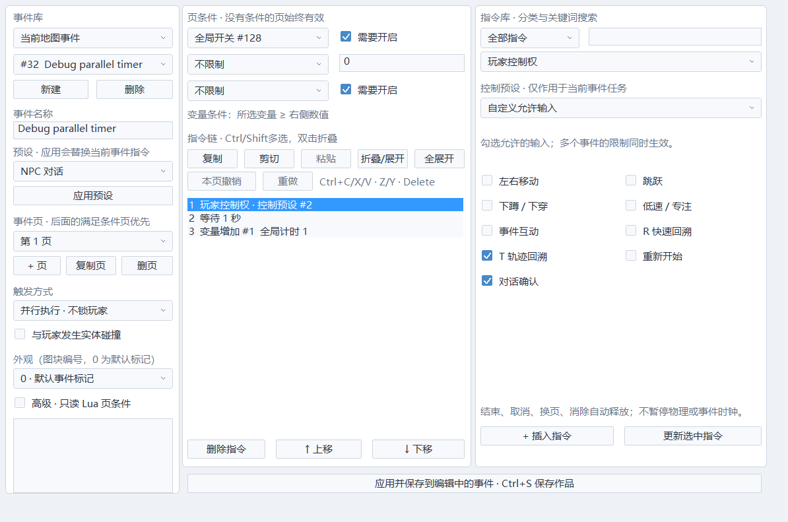
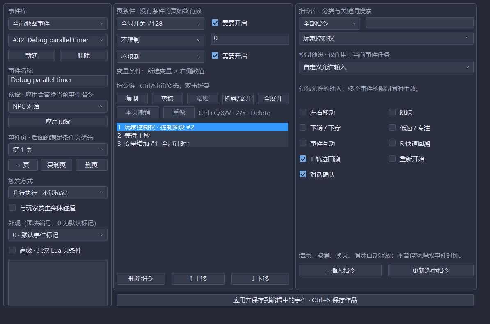

# 玩家控制权与事件取消

在地图或公共事件的指令类型中选择「玩家控制权」。常用流程直接选择预设；复杂规则选择「自定义允许输入」，勾选左右移动、跳跃、下蹲/下穿、低速、互动、R、T、重开、对话确认。无需 Lua。

每条指令更新**本事件当前任务**的请求，不会释放另一个事件的限制。「释放本事件」也不会提前解除前台事件本身的动作锁。

| 预设 | 行为 |
|---|---|
| 释放 | 清除本任务的显式请求 |
| 锁定左右移动 | 仅禁止玩家水平输入 |
| 锁定动作与互动 | 禁止移动、跳跃、下穿、低速、互动；保留回溯、重开、确认 |
| 禁止 R/T | 只禁止启动两种回溯 |
| 剧情控制 | 禁止动作、互动和R；保留T撤回、重开、确认 |
| 自定义 | 用九个勾选项设置允许输入 |

锁输入期间物理仍推进：重力、惯性、地形响应、敌人、弹幕、事件、音频和历史继续。它不能代替冻结全世界。并行事件链完成后会自动重启；要做一次性剧情，应使用开关条件或独立开关换页。

建议的练习：并行事件第一页条件为「开关1开启」，指令为「锁定动作 → 等待1秒 → 关闭开关1」。试玩中用调试器开启开关1；锁定时长按空格，结束后不会突然补跳。松开空格再按，恢复跳跃。另一个并行事件可独立禁止R/T；前一个事件结束不会解除后一个的限制。

## 谁决定输入和时钟

许可从 WorldState 计算，多个事件请求取交集，没有轮转顺序带来的最后写入覆盖。执行中的回溯优先读取历史，不受历史事件请求中途阻断；Hit优先允许T救回和重开，禁用回溯时Hit只允许重开。

| 状态 | 物理 | 事件 | 逻辑音频 | 历史 | 输入 |
|---|---|---|---|---|---|
| 普通/并行控制/前台等待 | 推进 | 推进 | 推进 | 记录 | 事件许可交集；前台默认锁动作 |
| 对话 | 冻结 | 推进 | 推进 | 记录 | 确认、回溯、重开，仍受显式事件限制 |
| 切图 | 冻结 | 冻结 | 推进 | 记录 | R/T，仍受显式事件限制 |
| Hit | 冻结 | 冻结 | 冻结 | 冻结 | T/重开；回溯关闭时仅重开 |
| R/T执行 | 从历史恢复 | 从历史恢复 | 从历史恢复 | 只读/截断 | 当前回溯键松开结束 |
| 游戏暂停/结束 | 冻结 | 冻结 | 冻结 | 冻结 | 暂停保留回溯/重开；结束保留重开且不被事件限制覆盖 |

回溯关闭时所有状态均停止历史记录。调试器的暂停是外层执行门，冻结全部模拟；不保存进游戏快照。设备实际播放与世界的逻辑音频游标分离，仍按原音频策略同步。

被禁止期间按住的跳跃、下穿、低速、互动、回溯、重开和确认，需要物理按键释放后重新触发。移动是连续输入，恢复许可即可继续移动。禁止跳跃会清除旧跳跃缓冲，避免落地后补跳。创建对话记录物理E状态，即使前台等待期间互动输入被过滤，长按E也不会自动确认新对话。脚本 Space/Down 钩子使用同一许可，不会绕过剧情动作锁。

自定义可以禁用对话确认。制作时应安排其他事件解除限制，或保留T/重开作为出口；引擎不会覆盖作者明确勾选的正常场景规则。Hit的救回优先级仍固定。

## 任务取消与公共调用

- 指令链正常结束、Exit、消除、页条件失效或换页，释放本任务的请求。
- 定义或地图放置已不存在时，取消遗留任务。
- 父事件取消时，沿有界公共调用链取消它所调用的子任务，关闭子任务拥有的对话。独立全局并行任务不被误取消。
- 离开地图取消地图任务及它们拥有的公共子任务；独立公共任务保留执行进度和请求。
- Hit取消全部当前事件任务及对话。T恢复旧快照时，恢复该时刻的请求、调用关系和输入锁存。
- 公共事件仍是16个共享执行槽，忙碌时调用者等待；没有独立实例创建策略。对话仍使用单一占用者，传送仍没有FIFO资源队列。

所有事件请求、允许位、调用者、调用代次和按键待释放标记都在快照中。固定48个执行槽；控制计算/取消/录制不在帧中分配C++堆内存。快照扫描同步覆盖新增字段。

「试玩调试器」显示当前控制者、四种时钟、待松键状态；事件行显示本任务许可及调用者。概览列出少量控制者，完整事件行可滚动检查。

事件格式保存为 ECHO_EVENTS_9，继续读取1–8；旧格式不能悄悄装载新控制指令。旧1/2的移动仍迁移为穿透，3/4保留碰撞移动设置。修改定义重新开始历史。

## 验证与剩余范围

21_player_control检查多所有者、自动释放、父子取消、Hit救回、按键长按、脚本钩子、格式版本、30/60/120Hz最远T/R后继续和零C++堆分配；07使用真实Win32表单和浅/深主题。

当前没有玩家剧情移动路线、菜单控制器、可配置全世界暂停时钟、镜头/对话/传送FIFO或公共独立实例。R05/R08仍保留这些待建项，不能把输入许可基础当作全部完成。
