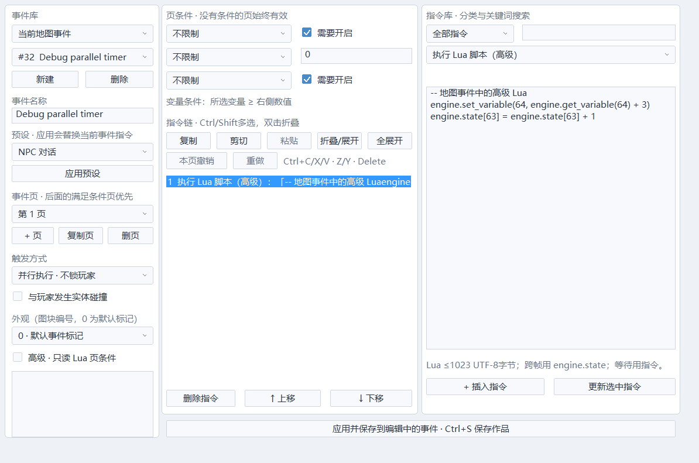

# 高级脚本扩展与逐项核对

常用制作使用预设和表单；复杂条件、组合机制或特殊行为使用高级脚本。这里分别记录底层API、可操作的入口和领域扩展缺口，完整范围见[需求清单](REQUIREMENTS.md)的S01。“支持Lua”不代表每项功能已有脚本入口。

## 在事件链插入Lua

1. 打开地图事件或公共事件，选择页。
2. 类型选“执行 Lua 脚本（高级）”，填写多行正文；单条最多1023个UTF-8字节，中文按编码字节计数。
3. 插入／更新指令，再应用。应用只编译，绝不提前执行玩法；失败保留已应用定义和草稿。
4. Ctrl+S保存；F5以最新定义重新开始试玩并编译缓存。地图／事件／弹幕共用撤销，纯选择／无变化应用不产生记录。
5. 等待、分支、传送、对话优先组合原有指令。脚本不挂起Lua栈，进度由事件PC／等待字段持有。

保存ECHO_EVENTS_10，继续读取1–9；旧v1–4拒绝脚本指令、旧v1–5拒绝循环指令，旧v1–6拒绝Lua条件指令。载入／试玩前编译全部地图和公共事件，运行按地图、事件ID、页、指令查缓存，不逐帧解析源码；修改定义重新开始历史。

~~~lua
-- 数据存在可回溯的C++变量中
local value = engine.get_variable(1)
engine.set_variable(1, math.min(value + 3, 100))
engine.set_self_switch("A", true)

-- 地图编号、是否公共、事件ID、页、指令
local map, common, id, page, command = engine.event_context()
engine.state[1] = engine.state[1] + 1
~~~

[石板灰深色](previews/event-script-dark.png)

复制用例见[scripts/event_command.lua](../scripts/event_command.lua)。这是插入正文范例，不应列入project.echo的启动scripts：事件上下文API只能在事件指令执行期间使用。

## 执行、预算、错误与回溯

一条脚本同步执行。每个模拟子步累计最多100000条Lua VM指令、32次事件Lua调用；不足1000条的短调用也占一次名额。指令超限停止请求者并锁存故障；页条件执行前预算已用完则延期该任务，避免把容量压力误当作脚本故障，不无限重试。整个Lua堆上限8MiB，项目脚本、编译缓存和临时值共享；Lua分配和GC仍有成本，不能保证所有Lua零分配。预算目前固定，完整配置表单和成本诊断仍待建。

缓存索引固定9×33×4×33个8字节项（32条指令加1个页条件、引用+条件种类），共313632字节，另预分配一个WorldState作为命令回滚副本，正常执行不动态建立索引。最多八张地图、32地图事件／16公共事件、4页、32指令，与事件系统一致。准备失败释放新编译引用，保留旧缓存和历史；准备过程临时索引和C++事件资料另占内存。

错误显示地图／公共、事件、页、指令；Lua语法／运行消息带源码行号。类型错误、无限循环、Lua堆超限均停止当前条。该条开始后的WorldState写入（变量、随机、对象、音频请求、配置等）全量回滚，先前成功指令保留。调度器停止所属任务及子任务、释放控制／对话；公共调用者能继续。缺少执行器同样故障，不能静默跳过。

故障锁存scriptFault进入EventRunner快照；换页、重开、重载定义、回溯到故障前可恢复。诊断文本是“最近一次错误”，回溯后可能仍保留；实际故障以快照runner为准。当前没有点击跳行或逐指令断点。

跨帧数据写入engine.state[1..64]、开关、变量、独立开关或现有状态API。engine.state目前是作品共享数值槽，local值仅存活本次执行。T恢复历史，R恢复世界而玩家走固定新直线；读取历史期间不重新执行脚本，截断后正向经过指令才再次执行。

## 环境与API

正文允许原生engine API、player／boss／jump／rewind／music数值代理、persistent、math／string只读接口，以及assert／error／ipairs／pairs／next／select／tonumber／tostring／type和弹幕DSL。engine.state与persistent指向同一快照存储。

顶层赋值、改写engine／math／string定义报错。没有OS／文件／网络、debug／package、load／dofile、协程或pcall入口。随机使用engine.random()，种子进快照。每次重设_ENV；局部函数／表只作本条计算，不能存入只接收数值的持久槽。这是状态一致性和能力边界，不是对任意恶意作品的通用安全承诺。

正文不能任意调用项目全局函数或读取Lua表。项目级钩子由project.echo的scripts顺序加载；闭包持久值需on_snapshot／on_restore同步，同名钩子后加载覆盖。项目脚本作者仍须同步所有可变全局／间接闭包；当前检查不能自动证明全部持久数据一致。外部命名函数、模块选择、参数表单和更完整的状态诊断仍待建。

| 已有入口 | 说明 |
|---|---|
| jump／rewind／player／boss／music | 当前WorldState代理，只访问绑定字段 |
| engine.state／persistent | 1–64有限数值，不保存表／函数 |
| get_switch／set_switch | 1–128全局开关 |
| get_variable／set_variable | 1–64，32位整数 |
| get_item_count／get_item／get_quest | 稳定ID1–1000000，缺失返回nil；副本查询允许用于只读条件 |
| change_item／set_quest_status／add_quest_progress | 数量/任务写入当前WorldState并返回结果码；只读条件禁写，详见[物品与任务](INVENTORY_QUESTS.md) |
| event_context() | 返回map, common, eventId, page, command；编号从1开始；页条件的command为0；仅事件脚本/条件 |
| get_self_switch／set_self_switch | 字母“A”–“D”，布尔值；仅当前地图／公共事件 |
| set_event_control(profile, mask=511) | 仅本任务；0释放、1–4预设、5自定义；mask 0–511；取消／结束自动释放，见[控制权](PLAYER_CONTROL.md) |
| request_transfer(map, x=0, y=0, spawn=true) | 现存地图1–8；spawn=false使用指定逻辑坐标（绝对值≤8192）；正式转场，已有请求时报错 |
| random() | 快照随机种子，0–1 |
| create_object／destroy_object／object_valid／damage_object | 模板ID或带代次句柄，创建满池返回nil |
| play_animation | 对象句柄／动画ID，见[动画制作](ANIMATIONS.md) |
| set_emitter／clear_bullet_group | 稳定ID／模式／组号，见[弹幕制作](BARRAGE.md) |
| configure_focus／configure_hurt／set_hurt_region | 玩家判定／低速，见[判定与显示](FOCUS_HIT_RENDERING.md) |
| collision_pair／set_collision_pair | 八类矩阵，见[碰撞分类](COLLISION_RULES.md) |
| play_bgm／stop_bgm／fade_bgm／play_se | 当前曲目和逻辑请求，不绕过音频预算 |
| volley／zone／barrage与DSL | Boss题型／程序，不等于通用对象弹幕伤害 |

例如：脚本设置许可→普通等待指令→另一条脚本释放；结束／取消也自动释放。

~~~lua
engine.set_event_control(5, 64 + 256) -- 只允许T和确认
-- 另一条脚本释放：
engine.set_event_control(0)
~~~

计算落点后用engine.request_transfer(2, 160, 592, false)，不直接改activeMap绕过转场。

## R01–R20高级入口审计

已有只覆盖左侧具体入口；右侧均为待建，不能视为已验收。

| 需求 | 实际已有入口 | 仍须补齐 |
|---|---|---|
| R01 对象／模板 | 创建／销毁／代次检查／伤害、实例副本查询、乘坐／挤压策略 | 完整运行属性、出生／销毁、独立数据／模板参数 |
| R02 资源 | 项目Lua资源导入／加载 | 查询／依赖／导入加工；独立工具脚本 |
| R03 动画 | 对象播放 | 任意角色、帧标记回调、可视绑定 |
| R04 碰撞 | 矩阵／判定；on_collision仅玩家弹幕，on_enter_region仅空间题 | 通用接触／进出／过滤、形状扩展 |
| R05 控制 | 按键／时间状态钩子、本任务许可 | 角色动作／路线／菜单API |
| R06 战斗 | Boss字段／攻击、对象伤害 | 受伤／死亡／掉落／阵营／阶段条件 |
| R07 弹幕 | DSL、发射器控制／清组 | 自定义逐弹／目标解析器／脚本预设 |
| R08 事件 | 多行Lua／上下文／独立开关／故障取消、指令链/页条件 | 外部函数／模块、独立实例／任务 |
| R09 地图 | 正式转场请求 | 进出／重进／死亡／读档／持久数据 |
| R10 摄像机 | 无完整Lua接口 | 跟随／目标／锁轴／区域／路径／震动／取消 |
| R11 游戏UI | 无Lua制作入口 | 数据绑定／布局／样式／交互／菜单所有者 |
| R12 对话 | 变量替换、逐选项只读Lua可用条件 | Lua直接打开对话／选项、输入／格式化／本地化 |
| R13 音频 | BGM／渐变／循环参数／SE | 多轨／总线／流式／优先级／生命周期 |
| R14 环境／shader | 自定义GLSL背景／转场 | Lua天气／灯／曲线／区域／参数绑定 |
| R15 输入／设置 | 部分按键、低速／判定 | 动作映射／手柄／设备／显示／无障碍 |
| R16 回溯 | 快照／恢复钩子、数值槽／串，事件故障入快照 | 新扩展全量恢复、可变全局／间接闭包诊断 |
| R17 性能 | 指令／堆／共享步预算、确定随机 | 成本分项／可配预算／质量API／统一提示 |
| R18 工程／发布 | Lua导出、载入／试玩编译 | API版本／模块依赖／存档／发布检查／构建钩子 |
| R19 编辑器 | 多行／语法定位／共享撤销 | 插件／补全／API浏览／跳行／断点／代码资产 |
| R20 预设／教程 | 本文和事件例子 | 参数schema／脚本预设／迁移／完整教程 |

## 下一阶段统一合同

每个高级入口有开关、执行时机、稳定ID、参数schema／单位／默认、例子、预览／重置；说明内置行为前／后、替代或只读通知。Lua使用同一验证API，回调返回命令或经验证参数，由有界队列提交，不留下删除后的指针。

任务、延时、独立数据放C++快照，不保存Lua协程栈。视觉脚本仅写视觉参数；编辑／导入／构建插件独立范围和事务。模块／函数检查捕获及可变全局，明确快照适配。

每项验证关闭高级功能的默认制作，以及错误／预算／目标复用／取消／并发、六秒各Hz最远T／R及禁用回溯。23_event_lua和原生07只证明现有事件入口。

环境参考[Lua 5.4官方手册的_ENV与加载规则](https://www.lua.org/manual/5.4/manual.html#2.2)，使用固定Lua 5.4.8手写绑定。

## 循环中的高级指令

可把本入口置于事件次数/持续循环体，按每次到达该PC时执行；等待仍使用普通指令。循环计数/端点属于C++快照，Lua持久数据用engine.state。重复脚本仍共用每子步32次/100000指令上限，达到上限会停止请求者，不能靠外层循环绕过预算。Lua失败清该任务循环及其公共子任务，释放控制，故障仍能回溯；不提供任意PC写入或Lua跳转。普通「跳出当前循环」可由开关/变量分支触发，指令链只读Lua条件已接入，事件页Lua条件已接入；外部表达式绑定仍待建。

指令链“条件：Lua（高级）”的完整读权限、严格单布尔返回和错误处理见 [事件制作](EVENTS.md)。条件和执行脚本共享步预算；副作用放进分支里的执行脚本。事件页条件的操作及规则见[页条件](EVENTS.md#高级事件页条件)；命名外部函数或其他领域高级入口仍待建。

可复制的条件例子见 [event_condition.lua](../scripts/event_condition.lua)，它不应登记为启动脚本。

## 快速回溯近弹规则

rewind.fast_stop_near_bullets 和 rewind.fast_bullet_margin 可由启动Lua或事件脚本直接设置，数据位于WorldState，快照/恢复无需额外钩子。常用制作入口是「作品 → 快速回溯规则」，默认开启/+2，范围0–64逻辑像素。不会改普通伤害半径、不清弹，T没有该截停。规则与测试见 [快速回溯](FAST_REWIND.md)。

逐选项高级可用条件已接入同一只读环境和编译缓存；UI与快照规则见 [条件选项](DIALOGUE_CHOICES.md)。它不等同于Lua直接创建任意对话/菜单的完整API。

W03高级入口已新增mobility可校验代理、player.climbing/inWater/dashRemaining/wallDirection/airDashAvailable、engine.get_platform/configure_platform及Dash动作钩子；查询副本可在只读条件使用，写入采用原有事件回滚。见 [平台机制](PLATFORM_PRESETS.md)。统一接触/碰撞回调、通用角色控制API仍待扩展。

升降平台高级参数为travel_x/travel_y/repeat_route，速度0暂停、delay控制端点停留；查询追加progress/direction。修改运行路线保持当前位置，所有路线参数与进度进入快照；完整规则和制作入口见 [平台机制](PLATFORM_PRESETS.md)。多节点/触发启停表单与任意对象乘坐仍待建设。

普通对象新增engine.get_object(slot,generation)只读副本查询和engine.configure_object_movement(slot,generation,{rides_platforms=...,crush_kills=...})；配置严格布尔，过期句柄拒绝，错误沿用事件全量回滚。模板表单提供同样开关，复杂逻辑不用隐蔽闭包计时。字段、单位、地图/代次、回溯及未覆盖范围见 [对象](OBJECTS.md#随平台移动与挤压)。这不代表完整对象属性/回调API都已完成。

## W01物品与任务的高级入口

常规制作使用六类原生指令；特殊条件可用get_item_count/get_quest，特殊奖励可用三种写接口。查询表只是副本，写接口执行严格整数/范围检查并共享事件Lua回滚与预算；所有持久结果在WorldState.progression。示例scripts/progression.lua默认不加载，不能把local表作为跨帧存储。当前未提供装备、道具效果、多目标依赖与奖励事务接口，完整W01仍待建设。

高级事件指令也参与[分类搜索、成组复制和折叠](EVENT_EDITING.md)：执行Lua/只读Lua条件/条件选项正文和参数深拷贝，不保存Lua栈；插入/更新/粘贴先编译，应用和试玩仍检查整个事件。错误保留原草稿及共享历史，实际脚本执行/故障回滚合同不变。新工具只编辑不可变定义，不提供跨工程模块依赖迁移。
