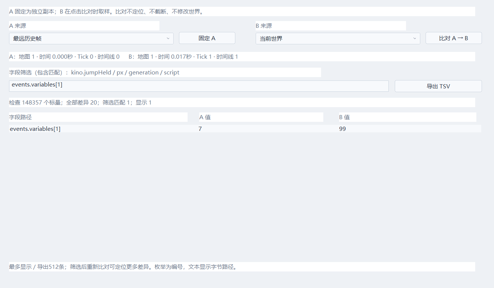

# 回溯诊断与快照比对

在「试玩调试器」点击「快照比对」。这是制作者调试工具，普通事件和弹幕制作仍使用预设及表单。

## 操作

1. 暂停在希望检查的时刻，选择 A 来源并点击「固定 A」。
2. 来源可选当前世界、调试时间轴所选帧、最远历史帧、最新历史帧。没有历史时仍可比较当前世界。
3. 单步或继续试玩，再暂停；选择 B 来源，点击「比对 A → B」。
4. 输入字段路径片段并再次比对。例如 kino.jumpHeld、kino.jumpWasCut、px、objects.slots、generation、script、barrage。
5. 「导出 TSV」保存当前筛选结果，可用文本编辑器或表格工具查看。

A 是完整独立副本，历史覆盖或截断后仍保留；B 在点击比对时取样，不是持续刷新指针。窗口显示双方地图、时间、tick 和时间线代次。比对与导出只读，不定位、不截断、不调用脚本钩子、不更改暂停状态。关闭调试器、关闭比对窗口或加载工程会释放比对缓存。

只读比对没有“恢复错误自动判定”：调试定位及回溯退出会按设计修改 timelineGenerationId、控制器和 R 落点等字段。先用字段筛选检查具体机制，再判断差异是否符合该分支规则。

实际原生窗口：



[石板灰深色预览](previews/snapshot-compare-dark.png) · [历史原因与调试器](previews/debugger.png)

## 字段完整性与容量

当前描述覆盖 55 种结构、625 个命名成员，每次扫描 154923 个标量，包括固定数组的未使用槽位、对象分配代次和文本尾部。FixedList 的 count 即使损坏也不会控制扫描长度。

C++ 填充字节不参与比较；浮点按位比较，正负零及不同 NaN 载荷会显示差异，相同 NaN 载荷不会误报。浮点同时显示数值和十六进制位模式；枚举显示编号，文本显示字节位置与 0–255 字节值。

最多保存、显示和导出 512 条差异，但仍统计全部差异与筛选匹配数。超限会提示缩小筛选；“匹配0条”不等于“世界完全一致”。输出使用固定缓冲，扫描期间没有 C++ 堆分配。A/B 加报告缓存约 1.1 MiB，在打开工具时分配；它们是编辑诊断缓存，不增加单个 WorldState 的大小，不在每个游戏帧扫描。

字段描述见 echo_engine/include/echo/snapshot_fields.hpp。新增、删除或改名快照成员会触发编译检查；修改后运行：

```powershell
python tools/generate_snapshot_fields.py
cmake --build --preset gcc-release
ctest --preset gcc-release --output-on-failure
```

生成器是维护工具，正常构建和发布不要求 Python。FixedList/Text 的专用遍历也检查成员数量；不要把新的持久字段藏到未遍历的容器或指针中。

## 历史为什么变短或清空

调试器分别显示：

- 请求窗口、保留的历史总跨度、当前游标实际可退时长。
- 有效占用、预留占用，以及按当前采样频率估算的容量时长。
- 预算不足、尚在积累、分支截断后重新积累、受击冻结或正在恢复历史。
- 最近清空原因与次数：加载工程、新试玩、重开、事件定义修改、应用判定/低速、碰撞分类或地图参数、资源重载、脚本重载、恢复草稿、显式开关回溯或运行时脚本开关。
- 本轮因容量覆盖、窗口淘汰、截断未来而丢弃的帧数，以及最近记录检测到窗口调小。

配置频率改变后，现有历史可能包含不同采样间距，因此容量时长明确标为按当前频率的估算；实际保留和可退时长来自快照时间。回溯期间总保留跨度可能大于当前游标可退时长。禁用时不记录；启动禁用不分配历史，运行时禁用保留已有预留。

原因和计数是只读运行日志，位于 History，不进入 WorldState，也不被回溯倒放；它们不参与任何玩法决策。玩法状态仍只由世界快照恢复。

## 验证

19_snapshot_diagnostics 验证深层字段、数组尾部、损坏计数、填充字节、浮点载荷、筛选超限和零堆分配；验证预算、截断、冻结、开关/重开原因；在30/60/120 Hz退到最远后继续T/R，并验证Lua捕获状态的序列化/恢复。

07_native_editor_gpu 操作实际窗口，验证固定A、筛选、TSV、浅/深主题、历史截断后的基线、只读世界/历史与关闭释放。对象创建/销毁/复用、跨地图与确定种子弹幕还分别由11_objects、05_audio_maps/08_events、15_barrage覆盖。
