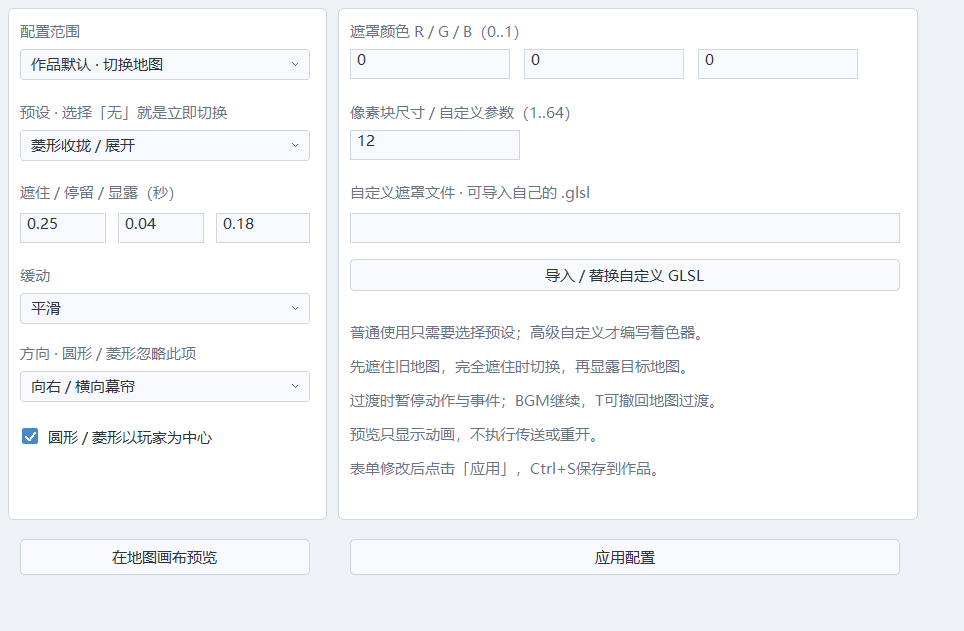
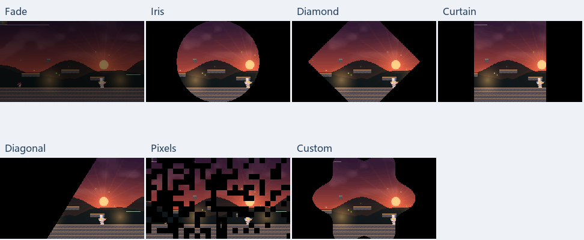

# 切图与重开动画（0.3）

参考方向是《蔚蓝》式短促的几何遮罩过渡。参考作品：[Celeste 官方网站](https://www.celestegame.com/)。预设和着色器均在 Echo Engine 中实现。

## 不写脚本使用

1. 点击编辑器顶部「切图动画」。
2. 配置范围选择「作品默认·切换地图」或「作品默认·死亡/手动重开」。
3. 选择预设，或选「无动画」立即切换。旧工程默认无动画，打开不会强制添加过渡。
4. 调整「遮住 / 停留 / 显露」三段时间（各0..10秒），选择缓动、方向、颜色。
5. 圆形/菱形可选择围绕玩家或画布中心；像素块大小1..64虚拟像素。
6. 点击「在地图画布预览」；预览不会执行传送、改变游戏或清空历史。
7. 点击「应用配置」，Ctrl+S保存；事件传送和普通传送区域都采用作品默认切图动画。

当前传送区域想使用不同效果：先在地图选择该区域，再打开窗口，配置范围选择「当前选中的传送区域」，勾选覆盖并应用。覆盖为「无动画」可以单独取消这个区域的过渡。关闭覆盖则继承作品默认。传送区域配置支持地图撤销/重做；作品默认参数目前通过应用和保存管理。



## 预设

| 预设 | 表现 |
|---|---|
| 无 | 保留立即传送/重开的行为 |
| 淡入淡出 | 用所选颜色遮住，再显露 |
| 圆形收拢 | 可见圆收拢到中心；新场景从中心展开 |
| 菱形收拢 | 菱形可见区收拢/展开 |
| 双侧幕帘 | 两侧向中间合拢/打开，可选横向或纵向 |
| 斜向擦除 | 斜边沿四个方向遮住/显露 |
| 像素块消隐 | 固定格块顺序与方向偏置，回溯后顺序一致 |
| 自定义 | 使用作品导入的GLSL遮罩函数 |

缓动有线性、平滑、缓入、缓出。颜色是RGB 0..1；通常选择黑色。预设默认时间为0.18/0.04/0.18秒，但默认类型为「无」。



## 游戏与回溯规则

过渡按 Closing → Covered → Opening 执行。旧地图在Closing保留；达到完全遮住的边界时执行一次传送，再停留/显露。目标地图摄像机瞬时定位，防止显露时从旧位置拖过去。

过渡期间玩家运动、敌人、弹幕和事件暂停，音频继续；过渡时钟与快照记录继续。旧对话窗口隐藏，不盖在遮罩之上。动画完成后下一次模拟步恢复动作。

WorldState包含默认切图/重开参数，以及本次锁定参数、阶段、阶段时间、待传送地图/位置、出生点选择、原因和重开输入边沿。控制锁、切图提交及重开完成不依赖渲染帧率。

T恢复相应的历史阶段；松开截断未来后继续，已经提交的Covered快照不会重复提交。30/60/120Hz均有“退到最远再继续”测试。遮罩GPU资源不进快照，只读当前进度。

Hit继续遵守原玩法：启用回溯时R禁用、T撤回；禁用回溯时等待重开。配置的死亡动画用于Enter重开，也用于手动重开；没有添加自动死亡重置。重开在完全遮住时恢复本次试玩的初始世界并建立新历史，随后显露。按住重开键不会连续启动同一动画。

零时长合法；三段均零时不会卡住。无动画不等待动画阶段。

## 自定义GLSL

点击「导入/替换自定义GLSL」，选择 .glsl 文件，选择「自定义GLSL遮罩」后应用。无需编写Lua。示例在作品 shaders/transition_custom.glsl。

当前每作品有一个自定义遮罩程序，所有选择Custom的过渡共用它，各自的时长/颜色/方向/中心/细节参数可以不同。导入会生成新的资源文件；编译错误保留原程序。着色器在加载/导入时编译，切图时不读盘或编译。

文件提供GLSL 1.20函数，不写main或#version：

```glsl
float echo_transition(vec2 uv, float cover) {
    float distanceFromCenter = length((uv-u_center)*vec2(1.7777778,1.0));
    return step((1.0-cover)*1.1, distanceFromCenter);
}
```

- uv：左上为(0,0)，右下为(1,1)。
- cover：0完全可见，1完全遮住；已经应用所选缓动。
- 返回遮罩不透明度0..1，颜色由表单控制。
- u_center：玩家/画布中心，规范到0..1。
- u_resolution：虚拟画布大小，目前320×180。
- u_detail：表单细节参数1..64。
- u_direction：0右、1左、2下、3上。
- u_phase：1收拢、2全遮、3显露。

引擎强制cover端点：0完全显露、1完全遮住，即使自定义函数在提交点返回0也不会暴露目标地图。自定义只能负责画面，不能决定切图时刻或持有跨帧玩法状态。

当前不提供逐帧贴图动画导入或可视关键帧时间轴；自定义通过GLSL遮罩函数完成。当前没有旧/新地图两张画面的平移或交叉混合。

## 工程与验证

作品默认保存为project.echo的map_transition/death_transition；自定义路径为transition_shader。每区域覆盖保存到ECHO_LEVEL_7，读取兼容旧1..6。

核心测试09_transitions覆盖序列化、遮住/提交/显露、冻结输入、音频、不同记录频率、最远回溯继续、关闭动画、零时长、禁用回溯重开和事件传送。原生GPU测试覆盖表单、区域覆盖撤销、全部预设/自定义编译，以及完全遮住/完全显露的实际像素检查。
