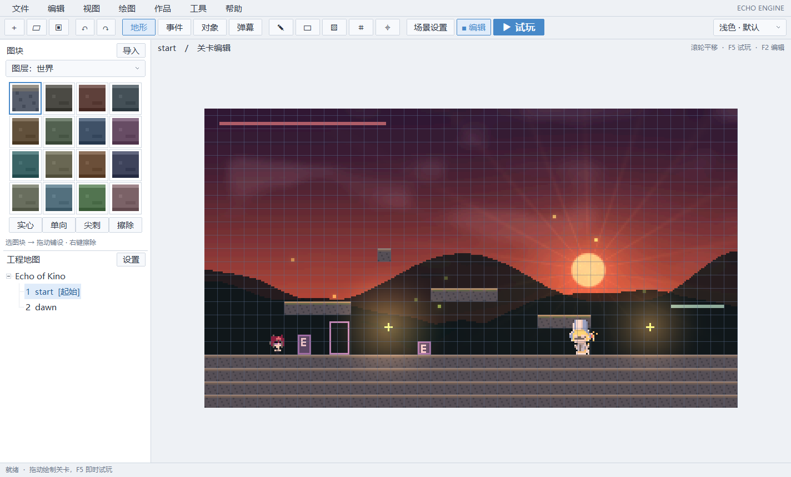

# 地图工作区：选图块、绘图和部署事件

主窗口采用常驻左栏和单行工具栏，详细配置从「作品」菜单和「场景设置」进入。截图来自实际Windows程序。

[深色](previews/editor-dark.png) · [窄窗口](previews/editor-compact.png) · [事件模式](previews/workspace-events.png) · [场景设置](previews/scene-settings.png)

## 主窗口操作

| 位置 | 用途 |
|---|---|
| 文件 | 新建、打开、保存、公开／加密导出 |
| 编辑 | 地图／事件／弹幕撤销和重做、图块选区复制／粘贴／擦除／翻转 |
| 视图 | 场景设置、图层显示与锁定、网格／碰撞、主题、恢复默认工作区 |
| 绘图 | 绘制、出生点、移动平台、灯光、对话／传送区域、五种碰撞与四邻接地形 |
| 作品 | 地图、事件、对象、弹幕、数据库、资源、动画、图层、对话、音频、转场、判定／低速／采样、碰撞类别、帧率 |
| 工具 | 试玩、返回编辑、调试器、工程检查／恢复、资源／Lua重载和弹幕压测 |
| 帮助 | 制作和快捷键说明 |

主窗口界面由引擎自带的绘制层 `echo::ui`（`ui.hpp` / `workspace_view.cpp`）完成：抗锯齿形状、矢量图标、自绘菜单和悬停提示，不使用原生控件或 ImGui；只有地图画布是独立子窗口。界面随系统 DPI 缩放。

顶部为菜单栏与工具栏：新建／打开／保存、撤销／重做、模式切换（地形／事件／对象／弹幕／机关）、绘图工具（画笔／矩形／油漆桶／框选／吸管），右侧是数据库、场景设置、深浅主题切换和绿色「试玩」按钮（试玩中变为红色「停止」）。窗口较窄时，右侧按钮和模式按钮会依次收起文字，只显示图标（悬停可看说明）。

左栏上方随模式变化：地形模式为图层分段、4×4 图块和笔刷类型（实心／单向／尖刺／擦除）；其他模式为当前地图的条目列表。左栏下方为地图列表，「+」新建地图，滑杆图标打开地图设置。画布上方显示当前工程、地图、编辑／试玩状态和未保存提示，底部为状态栏。

工具栏「场景设置」（或「视图 → 场景设置面板」）在右侧打开属性面板：手感与弹幕预设、环境与天气、雾和风速滑条、光照开关、回溯时长与频率，以及选中移动平台／灯光后的参数。滑条拖动即可调整（雾和风速实时生效，其余松手后生效并计入撤销），改动沿用原有的应用与保存规则。

菜单可用键盘打开：单按 Alt 打开「文件」，Alt+F／E／V／D／G／T／H 打开对应菜单，方向键选择，Enter 确认，Esc 关闭；试玩时 Alt 不会弹出菜单。

其余设置窗口暂时仍是原生控件，但外观已与主窗口统一：抗锯齿圆角卡片与按钮，「应用…」为主要按钮（蓝色），「删除／移除…」为红色文字；输入框有内边距、文字垂直居中，悬停与获得焦点时边框变色；列表与下拉项使用相同的选中样式。程序内嵌 Common Controls 6 清单，滚动条、消息框为现代样式，深色主题下使用系统深色滚动条。

设置窗口首次打开时按内容自动调整大小并居中到编辑器上方；Tab／Shift+Tab 在输入项之间切换（多行文本框保留 Tab 缩进），Esc 关闭窗口（下拉列表展开时先收起）。深色主题下主窗口与设置窗口使用系统深色标题栏（Windows 10 1809 及以上）。状态栏提示与操作错误提示均为中文。

开发时可用 `EchoEngine.exe --editor --project <工程副本> --ui-tour <输出目录>` 依次打开主窗口各状态和全部设置窗口，按浅色／深色各截取一次真实屏幕画面，便于逐窗口检查细节。

不启动编辑器也能查看界面效果：`cmake --build --preset gcc-release --target echo_ui_preview` 后运行 `echo_ui_preview <tiles.png> <画面.png 或 -> <输出目录>`，会用模拟数据输出浅色／深色、各模式、菜单和 150% 缩放的截图。

选择左侧图块，在地图拖动；右键擦除。图块选择保留单向／尖刺以及矩形／填充工具。当前仍最多16格，本轮没有增加多个图集的A/B页。左栏直接选择后景／世界／前景；自动生成世界碰撞选项在场景设置。网格是设备像素细线，关闭仍按格绘制，物理和快照坐标不受影响。

事件模式列出当前地图已部署的事件。点击列表定位，双击或「编辑选中项」设置页和指令链；空地单击部署，拖动移动。全局／公共库从「作品 → 地图／全局事件」进入；高级Lua执行和只读条件保留，见 [事件制作](EVENTS.md)。

对象模式列出可复用模板，先选模板再在地图放置；双击实例打开详细配置。弹幕模式列出当前地图已有发射器，可选择定位、拖动和双击编辑；新建仍从「作品 → 弹幕与波次」进入，见 [弹幕制作](BARRAGE.md)。

左下地图列表单击切换，切换前自动保存，清作者撤销栈并重开试玩历史；双击设置地图／卷轴。「起始」标识入口，改变入口后更新标识。当前最多八张地图。

## 偏好与边界

拖动左栏右侧分隔线，可在256–380逻辑像素（按 DPI 缩放）间调宽。主题、宽度、网格、碰撞显示和调试BGM静音保存到工程的.echo/workspace.echo（v2兼容v1），重开恢复。文件有版本号和4KiB读取上限；损坏或未知版本使用默认值并提示。「视图 → 恢复默认工作区布局」可重置。

这些是编辑偏好，不改WorldState、不标记地图脏状态、不截断历史。.echo目录不会进入公开／加密作品资源。场景设置关闭后保留控件，可再次打开；参数仍遵循原有应用／保存规则。

编辑状态栏显示地图、图层、工具、图块、锁定和未保存；试玩显示回溯时长、有效／预留历史内存与弹数，打开调试器时附加耗时。发布作品继续使用自己的提示。

主窗口已检查1280×760，最低1200×720。画布保持低分辨率虚拟画布和整数缩放，尚无任意缩放／任意尺寸地图。原生系统菜单与文件窗口仍受Windows主题影响。

本轮尚未完成自由停靠、任意布局、多选属性、跨图对象复制、最近工程、快捷键自定义和完整高DPI。事件／菜单／存档与各领域脚本仍按 [需求清单](REQUIREMENTS.md)建设。

## 验证

07_native_editor_gpu检查控件路由、常驻图块、模式列表、地图树、工具、窄窗口、分隔线、偏好恢复／失败回退、复用设置窗口及浅／深截图；全量比较WorldState和地图脏状态，确认偏好不改玩法。已有绘制／撤销／事件／脚本／弹幕与最远回溯继续验证保留。
